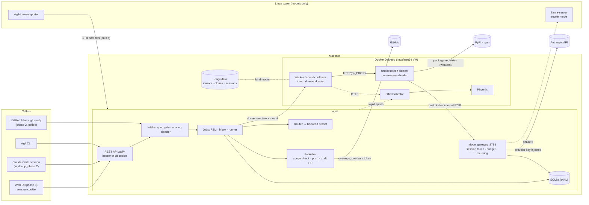
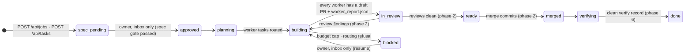
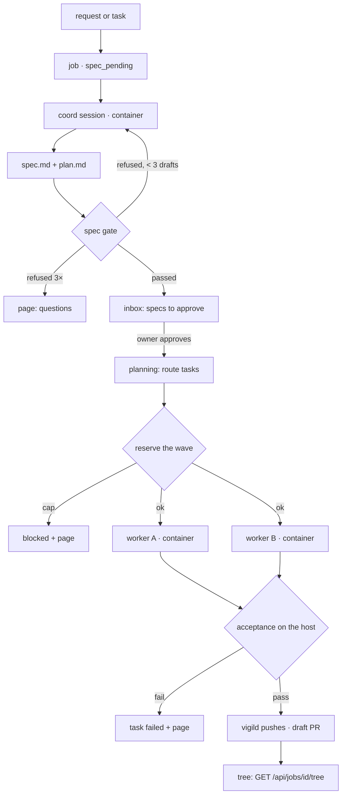

# Vigil architecture

How Vigil is built, which choices were made at build time and why, and the
seven-phase plan. `docs/design.md` is the spec; this file says how the spec
is implemented and where the implementation had to depart from it.
`docs/sources.md` cites every version and fact used here. Architectural
decisions after phase 1 are ADRs in `docs/decisions/`.

**Rule:** a PR that changes a flow shown here updates the diagram and the
matching row in `docs/feature-map.md` in the same PR. CI enforces it:
`scripts/check-docs-same-pr.py` fails a PR that touches a flow's files
without touching this file.

## Where things run

Two machines on one tailnet. The Mac mini runs everything except model
inference. The tower serves models and nothing else.

| Component | Runs where | How | Job |
|---|---|---|---|
| `vigild` | Mac mini | native Python 3.14 process (`uv run python -m vigild`; launchd in phase 2) | jobs and the inbox, routing, budgets, the model gateway, container lifecycle, metering, publishing, REST API, web UI |
| `vigil` CLI + MCP server | Mac mini (or any tailnet machine) | `uv run python cli/vigil …`; `vigil mcp` is phase 2 | thin clients of the REST API; `doctor` and `validate-images` in phase 1 |
| Claude executor | Mac mini, one container per session | Docker Desktop, linux/arm64 image | Claude Agent SDK, headless; coord, worker, reviewer and auditor sessions |
| OpenCode executor (phase 4) | Mac mini, one container per session | Docker Desktop, linux/arm64 image | `opencode serve` (v2) driven over HTTP |
| Egress proxy | Mac mini, one sidecar per session | smokescreen, linux/arm64 | the session's only route out, with its allowlist |
| Phoenix + OTel Collector | Mac mini | Docker Compose: Phoenix (one container) + the collector | one trace per session |
| `llama-server` (phase 5) | tower | systemd unit, prebuilt CUDA binary, router mode | Qwen3.6-35B-A3B, gpt-oss-20b, LFM2.5 decider |
| Tower exporter (phase 5) | tower | systemd unit, small Python service | GPU, VRAM, CPU, RAM, watts at 1 Hz |



## Build-time choices

Each row is a "pick at build time" from the design, or a choice the
design left open. These are decided; change one only through a PR that
edits this table (or, from phase 2 on, an ADR).

| # | Choice | Picked | Why |
|---|---|---|---|
| B1 | How `vigild` runs | Native on the Mac, not in a container (launchd from phase 2) | It creates clones on host paths and bind-mounts them, and it drives the Docker socket. A containerized vigild would need the socket (root-equivalent) plus host/container path translation for every mount, and would buy no isolation. |
| B2 | vigild's database | SQLite in WAL mode through the stdlib `sqlite3` module | One writer and one machine. No server, and no ORM dependency. |
| B3 | Workspace per task | A **per-task clone** from a local mirror (`git clone --local` hard-links objects), not `git worktree add` | A worktree's `.git` is a file pointing at the main repo's git dir on the host; that path isn't inside the mount, so git fails in the container. A local clone is self-contained, and its objects are hard links, so it's nearly free. |
| B4 | Egress enforcement | Each session gets its own `internal: true` Docker network. A **smokescreen** sidecar sits on that network and the default bridge, and the worker has `HTTP_PROXY`/`HTTPS_PROXY` set to it | Host nftables doesn't exist on Docker Desktop for Mac. An internal network has no default route, so the proxy is the only way out. smokescreen blocks private ranges by default; the one private address it opens is the gateway's (`allow_addresses: 192.168.65.254:8788`). Sessions aren't told apart by TLS, so `allow_missing_role: true` puts every request on the ACL's default policy. **DNS is not the boundary;** the tests assert a connection fails. |
| B5 | Proxy topology | One sidecar per session, its allowlist generated from the session's role. vigild also attaches the **OTel collector** to each session's internal network while the session runs (alias `otel-collector`); nothing else joins that network | The allowlist is exact per session: workers get package registries, coords none; nobody gets a model host or GitHub (P1, P2). Telemetry never passes through the proxy. The cost is about 20 MB per session. |
| B6 | Web UI stack | FastAPI serves static `index.html`, plain ES modules and one CSS file; live data is SSE read with `fetch()`. The design is in `docs/ui.md` | No build step, no framework, no vendored library. |
| B7 | API auth | Three bearer-token scopes: `VIGIL_API_TOKEN` (admin), `VIGIL_METRICS_TOKEN` (read) and `VIGIL_HEARTBEAT_TOKEN` (heartbeats only); an unset scope matches nothing. **The web UI never stores a token (P7: no):** `POST /api/login` takes the admin or read token once and sets `vigil_session`, a random id stored hashed: `HttpOnly`, `SameSite=Strict`, `Path=/`, 12 hours absolute, `Secure` when the UI is reached through `tailscale serve` (`api.cookie_secure`). A cookie-authenticated write must also carry `X-Vigil-UI: 1`. The UI binds to the Tailscale address only. The CLI and MCP keep bearer tokens | One credential store (the env file); Tailscale ACLs decide who reaches the port, the token or cookie decides what they can do. Plain HTTP on the tailnet can't carry a `Secure` cookie, so `Secure` follows the transport; WireGuard encrypts the tailnet. |
| B8 | MCP server | `vigil mcp`, a stdio server on the MCP Python SDK v2, calling the REST API through the CLI's client (phase 2) | The MCP server runs where Claude Code runs; stdio needs a command, not a URL plus a secret header. |
| B9 | HTTP client | `httpx2` everywhere, including the tests (`starlette.testclient` uses it) | One client. |
| B10 | Model swap and idle unload on the tower | **Decided (P6, owner 2026-10-22):** llama-server router mode (`--models-dir`, `--models-max 1`, `--sleep-idle-seconds 1800`). Phase 5 code | Nothing else installed on the tower, and no control channel from the Mac. vigild checks free VRAM before asking for a model. |
| B11 | Tower exporter | A ~150-line Python service: `nvidia-ml-py` + `psutil` + `prometheus-client`, systemd unit (phase 5) | NVML gives power, a cumulative energy counter, utilization and memory. |
| B12 | GPU attribution | Each 1 s sample goes to the session holding the llama-server slot, split when both are busy. With P1 the gateway sees every tower response, so phase 5 records llama-server's per-response `timings` there and matches slots exactly | `/metrics` and `/slots` have no client id; the gateway does. |
| B13 | Per-call metering | **The gateway (P1) meters every hosted call** it forwards: input, output, cache-read and cache-write (5 m and 1 h) tokens from the response's `usage` (or the SSE stream's `message_start`/`message_delta`), cost = tokens × `configs/prices.yaml`, plus the provider's own cost when it reports one (OpenRouter's `usage.cost`). vigild's own calls (the Haiku decider) go through the same code in process. Claude Code's OTel `api_request` events are dropped by the collector | One meter for every provider, on the wire, before any client-side estimate. |
| B14 | Budget hard stop | Every session (coord, worker, reviewer, auditor) and every vigild call **reserves** its `max_cost_usd` first. A reservation is refused unless spent today + open reservations + it ≤ the daily cap ($5), the same against the **monthly cap ($100, P4, mandatory)**, and the task's own spend + it ≤ the per-task cap ($2). A worker wave reserves all its workers before any starts; a refusal halts dispatch, blocks the job and pages you. **The gateway refuses any call whose worst case** (input estimated at 3 characters per token, plus `max_tokens` of output) would take its session past its reservation, before the call is sent. Days and months are UTC | Metered spend can't pass a cap: the worst-case estimate errs high, so the only overshoot is a call that would have fit. |
| B15 | Keys in containers | **None (P1, owner 2026-10-22).** A session gets a per-session gateway token on its stdin; the harness hands it only to the CLI child as `ANTHROPIC_AUTH_TOKEN`, with `ANTHROPIC_BASE_URL=http://host.docker.internal:8788`. vigild stores only its hash, revokes it when the session ends, and accepts it only on the gateway, only for the session's repo and backend | Replaces the file mount. The token is worthless outside the gateway, and the gateway enforces budget and policy on every call. |
| B16 | Guard in the Claude executor | At image build, claude-mods at the pinned SHA arrives as a **named build context** (a `git archive` of a local mirror), and the CLI's marketplace-add and install seed `guard@claude-mods` into `/opt/claude-seed` (`CLAUDE_CODE_PLUGIN_CACHE_DIR`); at run time `CLAUDE_CODE_PLUGIN_SEED_DIR`. The deny list, `enabledPlugins` and `claudeMods.guard` are in `/etc/claude-code/managed-settings.json` (checked: it is read). The SDK runs with `setting_sources=[]`, so no user or project settings load | No token at build time and nothing cloned at run time. The harness reads the SDK init message and **exits (3) if `guard` isn't among its plugins** (fail closed). |
| B17 | Non-root executor user | uid 10001, `--read-only`, `--cap-drop ALL`, `--security-opt no-new-privileges`, `--pids-limit 512`, 4 GiB memory, tmpfs `/tmp` | `bypassPermissions` refuses root; the design wants the rest. Each is checked in a real container (`tests/security/`). |
| B18 | Read-only overlays on the clone | `.github/`, `.claude/`, `.opencode/`, `.git/hooks/` and `.git/config` are bind-mounted read-only over `/work` (created empty when absent, so they can't be created either) | `bypassPermissions` lets the agent write `.claude/`. Hooks and `core.hooksPath` live in `.git/`. |
| B19 | GitHub App | One App, **vigil-worker**, for every role for now (ADR-0001: one App per role is deferred). It holds contents:write, pull_requests:write, issues:write, checks:read, metadata:read, artifact_metadata:read, and is installed on all eight of the owner's repos. vigild mints **only for repos in `configs/repos.yaml`**, plus claude-mods at `{"contents": "read"}` always; each permission has a ceiling (contents and pull_requests: write; metadata, issues: read); a token GitHub grants with more than asked (beyond its implicit metadata:read) is revoked. Variables: `GITHUB_APP_ID` (the JWT's `iss`) and `GITHUB_APP_KEY_PATH` | Without `workflows`, GitHub refuses a push touching `.github/workflows`. The installation's breadth is cut down in code, with a test per rule. |
| B20 | Where vigild's status issues live | In **this repo**, one issue per target repo (phase 2) | Coord's rules forbid writing to ParkAgent. |
| B21 | Decider routes | Jev on Cloudflare Workers AI (`POST /client/v4/accounts/{id}/ai/run`, model `typesafe/jev`); Jev on OpenRouter's Decisions API (`/api/alpha/decisions`, `typesafe/jev-1.13`, `provider.zdr`); Haiku 5.5 with `output_config.format` JSON schema and `effort: low`, through the gateway; LFM2.5 on llama-server (phase 5) | Jev's two routes are coded against synthetic fixtures until the Cloudflare token exists. vigild records the model version each answer reports and flags a change. |
| B22 | OpenCode v2 driving | `GET /api/info`, `GET /api/event` (reconnect and reconcile), `POST /api/session` + `/prompt`, `/diff`, `/interrupt`; no `ask` effects (phase 4) | v2's endpoints; its event stream is lossy. |
| B23 | Trace store | **Arize Phoenix 20.19.0** (owner decision 2026-10-22), one container, auth on, SQLite in a volume, behind the OTel collector (0.162.0) whose config is baked into a small image. vigild's spans: `vigil.session` (root) with `vigil.route`, `vigil.spawn`, `vigil.publish` under it; the worker's spans join through `TRACEPARENT`. Every span carries `session.id`, `vigil.task_id`, `vigil.job_id`, `vigil.tier`, `vigil.model`, `vigil.repo`, `vigil.branch`, `vigil.attempt`; the resource carries `openinference.project.name=vigil` | Langfuse v4 wants ~16 GiB; the Docker VM here is 12. The collector in front means the exporters never change; Langfuse stays an option for a bigger machine. |
| B24 | Lint, types, tests | `ruff`, `mypy --strict` on `vigild/` and `cli/`, `pytest`; CI jobs `lint`, `types`, `test` (plus the feature-map, CLAUDE.md and docs-same-PR checks in `lint`). `pytest -m docker` and `pytest -m live` run on the Mac and their output goes in the PR; CI deselects them | Docker and hosted calls aren't in CI. |
| B25 | Publishing | **vigild pushes and opens draft PRs from the host (P2, owner 2026-10-22).** After a worker exits, vigild checks stage-3 acceptance on the host clone; `vigild/github/publish.py` then refuses a branch that isn't `vigil/*` or changes a file outside the contract's scope (`.vigil/` artifacts excepted), pushes with a one-hour token passed in the git process's environment only, and opens a draft PR. A draft or nothing | "Merge or approve" loses its only token inside the container. |
| B26 | Dev images | Each repo pins `dev_image` and a smoke command in `configs/repos.yaml`. `vigil validate-images` runs the command (nightly, launchd) and records the image id; vigild refuses to start a session whose image was never validated, failed, was validated more than 26 h ago, or was rebuilt since | Owner decision 2026-10-22: a stale image is refused, not guessed at. |
| B27 | How the code runs | Not an installable package (`[tool.uv] package = false`): `uv run python -m vigild`, `uv run python cli/vigil …` | No unpinned build backend; one lockfile. |
| B28 | Per-layer packet budgets | The packet assembler budgets each documentation layer separately (layer 6 parent artifacts 6k tokens, layer 3 2k, layer 2 3k, files in scope 15k, related tests 4k, history 0.5k, ~4 characters a token) under an overall cap, and records every dropped item (in the packet and as a `packet` event) | Owner decision 2026-10-22 (documentation standard, phase 1). |

## Backends

A session's model backend is a config object, not a tier name
(`configs/backends.yaml`):

```yaml
presets:
  claude-sonnet: {kind: anthropic, base_url: https://api.anthropic.com, model: claude-sonnet-5-5, key_ref: ANTHROPIC_API_KEY, locality: hosted, provider: anthropic}
  claude-opus:   {kind: anthropic, …, model: claude-opus-5-5, …}
  claude-haiku:  {kind: anthropic, …, model: claude-haiku-5-5, …}
  tower-qwen:    {kind: openai_compatible, base_url: http://tower:8080/v1, model: qwen3.6-35b-a3b, key_ref: LLAMA_API_KEY, locality: local, provider: tower, live: false}  # phase 5
  tower-fast:    {kind: openai_compatible, …, model: gpt-oss-20b, …, live: false}                                                                            # phase 5
  openrouter:    {kind: openrouter, base_url: https://openrouter.ai/api/v1, model: null, key_ref: OPENROUTER_API_KEY, locality: hosted, provider: openrouter, live: false}  # phase 4
```

- **Tiers to presets.** `configs/routing.yaml` maps each tier to a preset.
  A tier whose preset isn't live yet falls back to `fallback`
  (claude-sonnet), and `tier_reason` says so. The coord's preset is
  `coord` (claude-opus).
- **Custom endpoints.** A session may carry a custom object; its `key_ref`
  must be a variable NAME (the contract model rejects anything shaped like
  a value).
- **Executor and backend compatibility.** Unchanged from the design:
  Claude executor ↔ `anthropic` (and OpenRouter's Anthropic models);
  OpenCode ↔ any. In phase 1 the gateway forwards `anthropic` only.
- **Private repos** (owner decision Q2, 2026-10-22). `configs/repos.yaml`
  lists, per repo, which backends and decider routes may see its text.
  - **Allowed for a private repo:** local presets, and one hosted route,
    `jev-cloudflare`.
  - **The one exception:** `anthropic` for `thomasbardhi01/vigil`,
    hard-coded in `vigild/repos.py` (a YAML key can't extend it).
  - **Refused at config load:** any other hosted backend, overflow or
    decider route for a private repo stops vigild. OpenRouter, even with
    ZDR, is never allowed.
  - **Checked again** at submit time, when a session's gateway token is
    issued, and on every call through the gateway.

## The job lifecycle



- `blocked` and `escalated` are reachable from every live state and
  resume only to the state they left, by the owner from the inbox.
- Every transition goes through `vigild/jobs/fsm.py`, checks its edge's
  acceptance in code, and writes a `state` event with its actor, channel
  and evidence. The owner's override (`force`) is logged and never skips
  approval.
- **Inside spec_pending.** A request (or a task with no `test_cmd` /
  `done_when`) starts a coord session that writes `.vigil/<job>/spec.md`
  and `plan.md`. vigild runs the spec gate; on a refusal the coord gets
  the errors and drafts again, up to three drafts, then you are paged. A
  complete task skips the coord: vigild writes a one-worker spec and plan
  from the contract (provenance `human`). Either way the job waits in
  *Specs to approve*.
- **Inside building.** Workers run in dependency waves; a wave's workers
  run in parallel, each in its own container, clone and `vigil/<task>`
  branch. After a worker exits, vigild reads `worker_report.json`, checks
  stage-3 acceptance on the host, and publishes (B25). A worker that
  writes `ask_coord.json` instead files a question for its coord and your
  inbox, and its task waits.



## Data (SQLite)

- `jobs`: one row per job: state, `blocked_from`, `parent_job_id` and
  `fix_depth` (lineage; depth ≤ 3), the coord session.
- `tasks`: the contract as routed: `tier`, `tier_reason`, preset, state.
- `sessions`: one attempt in one container; role `coord`, `worker`,
  `reviewer`, `auditor` or `subagent`; parent session (the tree); status,
  branch, PR, cost, tokens, trace id.
- `events`: every state change, executor event (`tool_call`,
  `tool_result`, `state`, …), packet drop log, gateway refusal and page.
- `artifacts`: every stage artifact by job and task, with its hash.
- `inbox_items`: the three queues (`specs`, `ready`, `questions`);
  `approvals`: who approved what, from where, with which edits.
- `model_calls`: one row per model call with tokens (in, out, cache read,
  cache write 5 m / 1 h), price-table cost, provider cost, latency, and
  (phase 5) llama-server timings.
- `reservations` and `ledger`: budget reservations and the spend they
  became.
- `gateway_tokens`: hashes of session tokens, with revocation.
- `decisions`: every decider answer, its probability, backend, model
  version and action.
- `dev_images`: validation records (B26). `ui_sessions`: hashed UI
  cookies (B7).

Every record table carries `provenance: claude | local | human`, enforced
by a CHECK constraint. `human` means not model output: you, or vigild's own
code. Hosted non-Claude output (Jev) has no value of its own and is tagged
`claude`, the conservative tag the training exporter refuses.

## KPIs (owner decisions 2026-10-22)

`vigild/kpis.py` defines them and computes each where data exists:
- **first-pass merge rate:** merged jobs that never went back from review
  to building, over merged jobs;
- **findings per PR, by severity:** from reviews (phase 2);
- **revert + fix-job rate:** fix jobs per shipped job;
- **cost per merged PR:** metered spend per merged PR;
- **median spec→merge.**

The raw data is stored from phase 1. The ladder, routing and the cost
model read these numbers from phase 2.

## Verification levels (owner decisions 2026-10-22)

- The spec schema has a `verify` field (`level`, `method`). Phase 1 builds
  level 0: example tests that fail first.
- `plan.md` carries one `verify` entry per acceptance criterion. An entry
  at level 0 must say `why_not_higher`. The plan schema enforces this, and
  the spec gate refuses a level that isn't built yet.
- Phase 2 builds level 1:
  - Hypothesis for Python;
  - SwiftCheck or parameterised swift-testing for Swift;
  - Schemathesis for OpenAPI routes;
  - Hypothesis stateful tests for `vigild/jobs/fsm.py`.
- Level 3 (models of ParkAgent's payment state machine and vigild's FSM) is
  scheduled after phase 2. Levels 2, 4 and 5 are later options.
- Audit sampling and promotion will weight criteria by level: a shape at
  level 0 is sampled harder and promoted slower. Phase 2 builds that.

## Security, as built on the Mac

The design's three layers. Where the Mac or an owner decision changed the
mechanism, the change is in bold. There is one test per row in
`tests/security/`; each starts a real worker container on its real network
and asserts the action fails. They ran on 2026-10-22 (PR description).

| Threat | Layer 1: GitHub | Layer 2: container | Layer 3: harness |
|---|---|---|---|
| Merge or approve | the App has no merge path that passes the ruleset; ruleset on `main` | **no token in the container (P2):** vigild publishes from the host; `gh` isn't in the image | guard plugin (pinned SHA) + managed-settings deny (`Bash(gh:*)`); the guard test runs a live turn |
| Push to main | ruleset | **workers never push:** the image's pre-push hook refuses every push; `.git/hooks` and `.git/config` read-only | guard; managed deny `Bash(git push:*)` |
| Deploy / prod | no Fly or prod credential anywhere | **per-session internal network + smokescreen allowlist:** registries and the gateway port only | managed deny `fly`, `curl`, `wget`, `ssh` |
| Read secrets | — | **no secret in the container at all (P1, P2):** no provider key, no GitHub token, the gateway token only on stdin; read-only root; only `/work` and `/tmp` writable; no Docker socket | guard (`.env*`, `run/**`) + managed deny (`Read(**/.env*)`, `Read(/run/**)`, `Read(/proc/*/environ)`) |
| Escape the worktree | — | only the clone (and the read-only packet) is mounted; uid 10001; `--cap-drop ALL`; pids 512; 4 GiB | `external_directory` denied (OpenCode, phase 4) |
| Change its own rules | **no `workflows` permission** | `.github/`, `.claude/`, `.opencode/` and the managed settings read-only | guard's self-protection; managed deny on edits there |

The guard test (`tests/security/test_guard_in_container.py`):
1. It starts the Claude executor image with a fixture repo, behind its
   proxy, with a gateway token for a $0.10 reservation.
2. It runs one headless Haiku turn, through vigild's real gateway, told to
   run `gh pr merge 1 --squash`.
3. It asserts three things:
   - the init message lists `guard`;
   - the tool result is a denial (guard's, with the managed-settings
     `blockedMessage`);
   - nothing ran: no "command not found".

It costs about $0.002.

Untrusted content (issue text, PR comments, failure logs) enters a packet
only through `vigild/packets/fence.py`. Its markers carry a nonce that the
content doesn't contain, so the content can't close the fence. A test
plants an injection in an issue body and shows that an
instruction-following stub calls no tool. A control test shows the same
stub does act on the text when it is unfenced.

## What Vigil reuses from claude-mods, and what it replaces

claude-mods holds four plugins, read at `c0fd9b1`.

- **guard: reused as is.** The executor image seeds it at the pinned SHA
  (B16), with vigil's deny list and guard config in managed settings. The
  OpenCode image (phase 4) mirrors its rules in `opencode.json`. Coord and
  local sessions keep it through `.claude/settings.json`.
- **fleet:** vigild's sessions list replaces fleet's view of workers; the
  coord keeps fleet's band and pane, and its CI column reuses fleet's
  `ciSummary` words (phase 2).
- **route: not used by workers.** Vigil's path rules use route's and
  guard's glob semantics (`vigild/intake/paths.py`):
  - without a `/`, a glob matches the basename anywhere;
  - with a `/`, it matches the path's tail;
  - matching is case-insensitive.
- **lean: not used.** The contract's scope and the host-side scope check
  do its job structurally.

## Seven-phase plan

**Seven phases (owner decision 2026-10-22).** One PR per phase, in order.
Each PR description ends with that phase's done-when check, actually run,
with its output pasted in. Phase N+1 is dispatched only after you merge
phase N. Coord reviews every PR with a fresh-context Opus subagent against
the checklist:
- tests fail before the fix;
- docs updated;
- no weakened tests;
- one way per thing;
- pins at least 2 weeks old;
- what could be deleted.

**Money.** The caps ($5 a day, $2 a task, $100 a month) bind what the
**vigil key** spends through the gateway: vigild's own sessions, reviews,
audits and decider calls. Coord's build workers and its PR reviews run on
your Max plan and aren't counted.

### Phase 1: Core (worker: Opus)

**Delivers** (this PR):
- **Skeleton:** `pyproject.toml` + `uv.lock` (Python 3.14.8, pins
  enforced by `exclude-newer`), ruff, mypy strict, pytest, CI (`lint`,
  `types`, `test`), the feature-map, CLAUDE.md and docs-same-PR checks, and
  vigil's own `CLAUDE.md` (P5).
- **Contract and jobs:**
  - the task, result, event, worker-report and plan schemas, generated
    from pydantic;
  - the spec gate (per task, and per job: tests per criterion,
    disjoint parallel writers, pinned interfaces, verify levels, money
    paths);
  - intake scoring;
  - the job model and tree with lineage;
  - the FSM with a test per transition;
  - stage artifacts under `.vigil/<job>/`.
- **Inbox and endpoints:**
  - `GET /api/inbox` with three queues, and `POST /api/inbox/{id}/approve`,
    the only exit from `spec_pending`;
  - `GET /api/jobs/{id}/tree`;
  - tasks, jobs, sessions and health;
  - bearer scopes, and the UI's login cookie (P7 no).
- **Routing and decider:**
  - rules 1–9 and presets;
  - the private-repo rule (Q2);
  - the decider with Haiku through the gateway, and Jev on fixtures.
- **Gateway, budgets, metering (P1):**
  - per-call metering against `configs/prices.yaml`;
  - reservations and the three hard stops;
  - provenance everywhere, and the training-exporter test.
- **Prompts and packets:**
  - four short role prompts;
  - six-part packets with per-layer budgets and a drop log;
  - fenced untrusted content and the injection test;
  - `ask_coord`.
- **GitHub (P2):**
  - App JWT and installation tokens, only for repos in `repos.yaml`,
    down-scoped and revoked;
  - claude-mods always read-only;
  - host-side publish;
  - per-task clones from mirrors.
- **Containers:**
  - the executor image (CLI 2.1.306, guard seeded, managed settings,
    non-root, read-only);
  - the smokescreen sidecar;
  - container lifecycle;
  - pinned and validated dev images;
  - `compose.yaml` with Phoenix and the collector;
  - the security tests.
- **The coord loop end to end** on a fixture repo: with a stand-in
  executor in CI, and with real containers and Haiku on the Mac.
- `vigil doctor` and `vigil validate-images`; KPIs defined.

**Done when** (owner): an approved spec on ParkAgent produces a coord that
writes `spec.md` and `plan.md`; the owner approves from the inbox; two
workers build in their own containers; both open draft PRs through the
vigil-worker App, each with `worker_report.json`; the job tree is readable
from one endpoint. The coordinator runs it after the owner confirms that
ParkAgent's coord is idle, and pastes it into the PR.

**Needs from you:** the Phoenix secrets and `VIGIL_API_TOKEN` in the env
file (runbook). The Cloudflare token is optional, because Haiku covers.

### Phase 2: Review ladder, fleet, CLI and MCP, session proxy (worker: Opus)

- **Review:**
  - reviewer (Sonnet) and auditor (Opus) sessions;
  - rung 0 with a 100% audit;
  - `configs/review.yaml` with promotion and demotion from match rates,
    weighted by verify level; money shapes are never promoted.
- **Fleet:**
  - the scheduler (dependency graph, three in parallel);
  - the WIP limit of 4;
  - escalation that forks full context;
  - `vigil:ready` label intake.
- **Clients:** the `vigil` CLI (`run`, `batch`, `ls --live`, `trace`,
  `kill`) and `vigil mcp`.
- **Session proxy:** read and join a live session's transcript; your
  messages are logged as `provenance: human`.
- **Bridge:** the message bus, the MCP tools (`vigil_talk`,
  `vigil_listen`) and `vigil-bridge`.
- **Documentation and verification:**
  - documentation layers 4, 5 and 7, the search subagent, and the staleness
    score;
  - verification level 1.
- **Done when:** three batch tasks run in parallel and are reviewed and
  audited; `vigil kill` works; one is dispatched from a Claude Code session.
- **Spend:** about $4.65 at worst, inside one day's $5.

### Phase 3: Web UI and metering (worker: Sonnet)

- **Delivers:**
  - the UI in `docs/ui.md`, eight pages including `/talk`, served on the
    Tailscale address only, with the cookie login;
  - `GET /api/metering` and `/metrics` behind the read token.
- **Done when:** the list in `docs/ui.md` passes.
- **Spend:** about $1.

### Phase 4: OpenCode executor (worker: Sonnet)

- **Delivers:**
  - the OpenCode v2 image (B22), with Claude through the gateway, then
    OpenRouter;
  - the same contract suite for both executors.
- **Done when:** the same docs task passes through both executors with
  identical results and traces.
- **Spend:** about $2.

### Phase 5: Tower (worker: Sonnet)

- **Delivers:**
  - llama-server in router mode (B10) and `tower/models.lock`;
  - the exporter and GPU attribution (B11, B12);
  - the tower presets and the LFM decider;
  - the tower in the gateway and the proxy allowlist.
- **Done when:**
  - `tower/check.sh` passes;
  - one local task opens a PR;
  - tokens/s, J/token and GPU-s/token are recorded and shown.

### Phase 6: Post-merge, fix jobs, auto-merge (worker: Sonnet)

- **Delivers:**
  - the post-merge watcher (CI plus the nightly suite, a 48 h window);
  - fix jobs as children with the coord resumed and the lineage shown;
  - auto-revert;
  - auto-merge for shapes at rung 3, per the design's conditions.
- **Done when:** defined with the owner when the phase is dispatched.

### Phase 7: Eval (worker: Sonnet)

- **Delivers:** `evals/run.py` over workers, reviewers and deciders, and
  `routing.yaml` / `review.yaml` edited from the results.
- **Done when:**
  - `evals/2026-xx/results.csv` is committed;
  - the first shapes are at rung 1;
  - the cost table uses real numbers.
- **Spend:** roughly $25–40. It needs a one-time eval budget from you.

## Decisions (owner, 2026-10-22)

| # | Question | Decision |
|---|---|---|
| Q1 | Claude Code version for the executor image | **2.1.306**, an owner exception to the two-week rule because Claude Code is the harness. It runs from claude-agent-sdk 0.2.165 through `cli_path`. |
| Q2 | Private repos vs self-maintenance on Claude | `repos.yaml` lists `anthropic` for `thomasbardhi01/vigil` only. Any other hosted entry for a private repo, except `jev-cloudflare`, stops vigild (tested). |
| Q3 | The warn colour fails contrast | `--sonar-2` becomes `#346E93` (`--ink` on it is 4.69:1). `--dim` stays `#6B7580`. Final hexes are in `docs/ui.md`. |
| P1 | A model gateway in vigild | **Yes.** B13, B14, B15; B12 in phase 5. |
| P2 | vigild pushes and opens PRs from the host | **Yes**, built directly: B25. Workers hold no GitHub token, and GitHub isn't on their allowlist. |
| P3 | Python 3.14 | **Yes:** 3.14.8. |
| P4 | Monthly cap | **$100**, mandatory. |
| P5 | vigil's own `CLAUDE.md` | **Yes:** at most 200 lines (CI checks), with `AGENTS.md` a symlink. |
| P6 | llama-server router mode | **Yes:** B10 (phase 5). |
| P7 | UI token in `localStorage` | **No.** The HttpOnly session cookie (B7). |
| — | One GitHub App per role | Deferred: ADR-0001. |
| — | Trace store | Phoenix replaces Langfuse (B23). |
| — | Phases | Seven (above). |

### Resolved without asking (still in force)

- **Tower metering phase:** with the tower, in phase 5.
- **Tower secret:** the tower keeps `LLAMA_API_KEY` in
  `/etc/vigil/llama.env` (runbook).
- **Where tokens live outside the env file:** nowhere. The CLI reads the
  env file; the UI holds a cookie, not a token.

## Where this departs from the design, and why

1. **`git worktree add` + mount** can't work in a container (B3).
2. **nftables egress** doesn't exist on Docker Desktop for Mac (B4). DNS
   isn't a boundary there; no route plus the proxy is.
3. **OpenCode.** v2 shipped on 2026-09-11, so the session flow uses v2
   endpoints, `serve` has no `--auto`, and v2 `read` paths are relative
   (B22).
4. **llama-server.** `--metrics` can't attribute GPU time per task (B12);
   router mode replaces the swap script (B10); `--jinja` and `--slots` are
   defaults.
5. **The trace store** is Phoenix, not Langfuse (B23, owner decision).
6. **Jev.** OpenRouter's id is `typesafe/jev-1.13` on its Decisions API;
   Cloudflare's model is unversioned with 32k context (B21).
7. **Cost.** The SDK's cost is a client estimate; the gateway meters
   instead (B13).
8. **Keys.** No provider key and no GitHub token in any container (P1,
   P2), where the design had a key file and a tmpfs token.
9. **One GitHub App per role** is deferred (ADR-0001).
10. **The cost model.** The design assumes $40/day; at $5/day the fleet
    runs roughly 3–6 Sonnet tasks a day with reviews.
11. **Docker Desktop can't read `~/Documents` on this Mac.** Nothing
    vigil runs bind-mounts from the repo: the collector's config is baked
    into its image (runbook).
12. **Draft PRs on private repos.** This PR is a draft on the private
    vigil repo; whether the App can open one there is answered by the
    done-when run.
