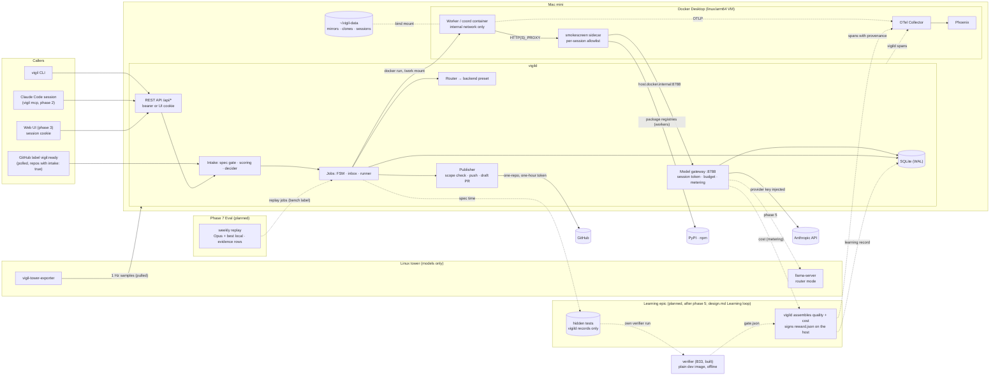
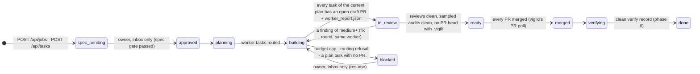
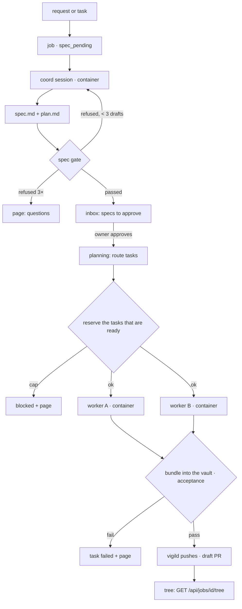

# Vigil architecture

How Vigil is built, which choices were made at build time and why, and the
seven-phase plan with the learning epic after phase 5. `docs/design.md` is the spec; this file says how the spec
is implemented and where the implementation had to depart from it.
`docs/sources.md` cites every version and fact used here. Architectural
decisions after phase 1 are ADRs in `docs/decisions/`.

**Rule:** a PR that changes a flow shown here updates the diagram and the
matching row in `docs/feature-map.md` in the same PR. CI enforces it:
`scripts/check-docs-same-pr.py` fails a PR that touches a flow's files
without touching this file.

## Where things run

Two machines on one tailnet. The Mac mini runs everything except model
inference. The tower serves models and nothing else.

| Component | Runs where | How | Job |
|---|---|---|---|
| `vigild` | Mac mini | native Python 3.14 process (`uv run python -m vigild`; launchd in phase 2) | jobs and the inbox, routing, budgets, the model gateway, container lifecycle, metering, publishing, REST API, web UI |
| `vigil` CLI + MCP server | Mac mini (or any tailnet machine) | `uv run python cli/vigil …`; `vigil mcp` is phase 2 | thin clients of the REST API; `doctor` and `dev-image` in phase 1 |
| Claude executor | Mac mini, one container per session | Docker Desktop, linux/arm64 image | Claude Agent SDK, headless; coord, worker, reviewer and auditor sessions |
| OpenCode executor (phase 4) | Mac mini, one container per session | Docker Desktop, linux/arm64 image | `opencode serve` (v2) driven over HTTP |
| Egress proxy | Mac mini, one sidecar per session | smokescreen, linux/arm64 | the session's only route out, with its allowlist |
| Phoenix + OTel Collector | Mac mini | Docker Compose: Phoenix (one container) + the collector | one trace per session |
| `llama-server` (phase 5) | tower | systemd unit, prebuilt CUDA binary, router mode | Qwen3.6-35B-A3B, gpt-oss-20b, LFM2.5 decider |
| Tower exporter (phase 5) | tower | systemd unit, small Python service | GPU, VRAM, CPU, RAM, watts at 1 Hz |



The nodes inside *Learning epic* and *Phase 7 Eval* are planned and not
built. The verifier beside them is built (B33). It will compute only the
gate tier, as `gate.json`; vigild assembles the rest on the host, where
the signing key lives. The owner's rulings of 2026-10-23 that shape this
are listed at the end of `docs/design.md` "Learning loop".

## Build-time choices

Each row is a "pick at build time" from the design, or a choice the
design left open. These are decided; change one only through a PR that
edits this table (or, from phase 2 on, an ADR).

| # | Choice | Picked | Why |
|---|---|---|---|
| B1 | How `vigild` runs | Native on the Mac, not in a container (launchd from phase 2) | It creates clones on host paths and bind-mounts them, and it drives the Docker socket. A containerized vigild would need the socket (root-equivalent) plus host/container path translation for every mount, and would buy no isolation. |
| B2 | vigild's database | SQLite in WAL mode through the stdlib `sqlite3` module | One writer and one machine. No server, and no ORM dependency. |
| B3 | Workspace per task | A **per-task clone** from a local mirror, `git clone --no-hardlinks` (copied objects, so a worker can't write through a shared inode into the mirror), with **no remote**; vigild records the base commit it cloned at outside the clone. Mirrors are fetched with a read-scoped App token, one fetch at a time per repo, ignoring host git config and credentials | A worktree's `.git` points outside the mount, so git fails in the container. A clone is self-contained. Review round 1 (blocker 2, item 22) removed the shared inodes, the forgeable `origin/<base>` and the ambient credentials. |
| B4 | Egress enforcement | Each session gets its own `internal: true` Docker network. A **smokescreen** sidecar sits on that network and the default bridge, and the worker has `HTTP_PROXY`/`HTTPS_PROXY` set to it | Host nftables doesn't exist on Docker Desktop for Mac. An internal network has no default route, so the proxy is the only way out. smokescreen blocks private ranges by default; the one private address it opens is the gateway's (`allow_addresses: 192.168.65.254:8788`). Sessions aren't told apart by TLS, so `allow_missing_role: true` puts every request on the ACL's default policy. **DNS is not the boundary;** the tests assert a connection fails. |
| B5 | Proxy topology | One sidecar per session, its allowlist generated from the session's role. Workers get PyPI (`pypi.org`, `files.pythonhosted.org`; uploads go to `upload.pypi.org`, not listed); coords, reviewers and auditors get nothing but the gateway. **No npm** (review r1, item 12): the npm registry takes publishes on the host it serves reads from, and smokescreen can't filter methods, so a repo's npm dependencies are baked into its dev image. vigild attaches the **OTel collector** to each session's network (alias `otel-collector`) | The allowlist is exact per session; nobody gets a model host or GitHub (P1, P2). Telemetry never passes through the proxy. |
| B6 | Web UI stack | FastAPI serves static `index.html`, plain ES modules and one CSS file; live data is SSE read with `fetch()`. The design is in `docs/ui.md` | No build step, no framework, no vendored library. |
| B7 | API auth | Three bearer-token scopes: `VIGIL_API_TOKEN` (admin), `VIGIL_METRICS_TOKEN` (read) and `VIGIL_HEARTBEAT_TOKEN` (heartbeats only); an unset scope matches nothing. **The web UI never stores a token (P7: no):** the UI's login exists **only on the listener bound to the Mac's Tailscale address** (`api.tailscale_host`; without it the UI login is off). `POST /api/login` there takes the admin or read token once and sets `vigil_session`, a random id stored hashed: `HttpOnly`, `SameSite=Strict`, `Path=/`, 12 hours absolute, and `Secure` whenever the request arrived over HTTPS (`tailscale serve` sets `X-Forwarded-Proto: https`) or `api.cookie_secure` is set. A cookie-authenticated write must also carry `X-Vigil-UI: 1`. The loopback listener has no login and ignores cookies: it is the CLI's and MCP's, bearer only | One credential store (the env file); Tailscale ACLs decide who reaches the port, the token or cookie decides what they can do. Plain HTTP on the tailnet can't carry a `Secure` cookie, so `Secure` follows the transport; WireGuard encrypts the tailnet. |
| B8 | MCP server | `vigil mcp`, a stdio server on the MCP Python SDK v2, calling the REST API through the CLI's client (phase 2) | The MCP server runs where Claude Code runs; stdio needs a command, not a URL plus a secret header. |
| B9 | HTTP client | `httpx2` everywhere, including the tests (`starlette.testclient` uses it) | One client. |
| B10 | Model swap and idle unload on the tower | **Decided (P6, owner 2026-10-22):** llama-server router mode (`--models-dir`, `--models-max 1`, `--sleep-idle-seconds 1800`). Phase 5 code | Nothing else installed on the tower, and no control channel from the Mac. vigild checks free VRAM before asking for a model. |
| B11 | Tower exporter | A ~150-line Python service: `nvidia-ml-py` + `psutil` + `prometheus-client`, systemd unit (phase 5) | NVML gives power, a cumulative energy counter, utilization and memory. |
| B12 | GPU attribution | Each 1 s sample goes to the session holding the llama-server slot, split when both are busy. With P1 the gateway sees every tower response, so phase 5 records llama-server's per-response `timings` there and matches slots exactly | `/metrics` and `/slots` have no client id; the gateway does. |
| B13 | Per-call metering | **The gateway (P1) meters every hosted call** it forwards: input, output, cache-read and cache-write (5 m and 1 h) tokens from the response's `usage` (or the SSE stream's `message_start`/`message_delta`), cost = tokens × `configs/prices.yaml`, plus the provider's own cost when it reports one. **Fails closed:** if recording a call fails (`record_call`, the ledger), the gateway revokes the session's token, books the call's worst-case hold as spent (unknown is never zero), marks the session failed, stops its container (`DockerRuntime.stop`) and pages the owner "metering failed: <error>; spend for call <id> not booked". The runner's end-of-session settle fails closed the same way: if it raises, the whole reservation is booked as spent (never $0), the session is failed and the owner paged with the call's model and token usage. vigild's own calls go through the same path: Haiku in process, and **Jev through `Gateway.metered`** (route check, reservation, one row per call; review r1, item 11). Claude Code's OTel `api_request` events are dropped by the collector | One meter for every provider, on the wire, before any client-side estimate. |
| B14 | Budget hard stop | Every session and every vigild call **reserves** its `max_cost_usd` first. A reservation is refused unless spent today + **every open reservation** + it ≤ the daily cap ($5), the same against the month (**$100, P4, mandatory**), and the task's own spend + it ≤ $2. An open reservation counts against today's and this month's caps whatever day it started (2a round 7): a session still running at UTC midnight books its whole cost to the day it settles, so the new day must already see it; one a crash left open is settled by the startup reconcile, and every 10 minutes a sweep settles any open reservation nothing live holds, so a leak can't block later days. One rule decides what is live, for the sweep and the reconcile alike (`JobRunner._reservation_live`, 2a round 9): first a call the gateway still has in flight against the reservation, or a settle waiting for one (`Gateway.holds`: a session's calls, or vigild's own Jev or Haiku call), live until nothing of the call has moved for the upstream read timeout plus 2 minutes (each streamed chunk counts); then, except right after a restart, a session still created or running, a review stage whose pass is running, a worker reservation whose task is running. Every path that reserves and can then fail releases what it reserved (a retry the router refuses, a review stage's first write, a review session that never starts). A session settles once the gateway has booked its calls in flight; one that outlives the wait leaves the reservation open, counted and live, until it is booked (`Gateway.after_drain`), then settles and runs the spend check. A metered call (Jev) reserves its worst case from its body, and a settle never books more than was reserved: an excess is recorded (`settle_excess`) and trips the daily breaker (2a round 8), on both of vigild's own call paths, Jev and the Haiku decider (`Gateway._own_call`, 2a round 9). If recording one of those calls fails, its reservation is booked and the owner is paged that it may be counted twice (exactly-once settle: #29). Tasks that become ready together reserve all their budgets before any starts (phase 1's waves; the graph scheduler, B43), each for what is left of its own cap (a job's peak is max(coord $2, the first wave's workers, its review-stage reservation); **a reservation the day has no room for waits instead of failing**: the runner polls (`QUEUE_POLL_SECONDS`) until a reservation settles or the UTC day rolls over, writing a `queued` and then a `dequeued` event; the queue is first in, first out (a new request waits behind any older waiter, so a small one can't take the money a large one is owed), and every poll re-checks the job: one that was abandoned or moved on ends the wait (`dequeued` with `cancelled`), uses no attempt and pages nothing; a restart drops the waiters with the process, and the reconcile pages the job as any mid-flight one; a wave of three workers at $2 against $5 runs two and the third waits; only a day that is full of reservations waits: a task's cap, the month, an amount over the whole day, or a day whose metered spend has reached the cap still refuse or trip the daily breaker). A refusal halts dispatch and **gives the job its own page** (retry on what's left of each task's cap, re-plan, abandon); a task whose own cap is spent trips its per-task breaker; **the global daily or monthly breaker trips only when metered spend reaches the cap** (checked after every session settles; a session settles only once the gateway has booked its calls in flight, `Gateway.drain`, so a killed worker's last streamed call is in the ledger before its resume reserves the remainder), never because open reservations fill the day. **The gateway holds each in-flight call's worst case** (every input token at the 1-hour cache-write rate, plus `max_tokens` of output) against the session's reservation until the call settles, and refuses a call that doesn't fit after the holds (review r1, item 6). **Each call's output is capped:** `session_max_output_tokens` (16,384, `configs/budgets.yaml`) is set on every coord and worker session as `SessionSpec.max_output_tokens`, passed to the container as `VIGIL_MAX_OUTPUT_TOKENS`, and mapped by the entrypoint to the CLI's `CLAUDE_CODE_MAX_OUTPUT_TOKENS`; without it Claude Code asked Opus for a very large `max_tokens` and the first call's worst case ($3.0751) exceeded the coord's $1 reservation (pa-0001); the coord's reservation is now $2 (`coord_session_usd`) because at $1 an Opus coord was refused mid-session once its request reached about 230-270k characters, and at $2 the refusal comes at about 600k characters with ~$0.30 already spent. **The gateway clamps as well:** it forwards `max_tokens` as the least of the request's value, the cap, and what the reservation affords after the call's input; below a 4,096-token floor it refuses, naming the cap. A `thinking` budget is clamped so 4,096 tokens of the clamped `max_tokens` remain for the answer (thinking counts as output); if less than 1,024 would be left for thinking it refuses. A response with `stop_reason: max_tokens` is stored on its `model_calls` row (`truncated`) and as a `call_truncated` event, and a session whose final call was truncated is `failed` ("the final turn was truncated at the output cap"), never done. **First-call check:** `vigild/gateway/firstcall.py` prices every role's first call (200,000 characters in, the cap out) against its reservation ($2 coord, $2 per task, `hidden_tests_session_usd` $1 for the hidden-test author on the reviewer tier; the reviewer and auditor against the daily cap, since a review sits outside the task's cap and an over-cap review grows against the day); a CI test runs it over `configs/routing.yaml`, and `POST /api/jobs` and `POST /api/tasks` run it for the repo before anything exists, refusing with a 422 that carries the numbers, so no container starts and no attempt is used. **Review and audit caps** (owner, 2026-10-23; `review_session_usd` $0.40, `audit_session_usd` $0.80, starting values to re-size from real ParkAgent reviews after the phase 1 run): when a job enters review it makes **one** reservation for the pass, (reviewer cap + auditor cap) × the tasks under review, **at most 4 tasks a pass** (owner, 2026-10-23: a job with more is reviewed in passes of 4, each reserving for its own after the last one's stage went back, so no job is refused for its task count; the coord prompt and the plan schema say so); each reviewer and auditor session draws its cap from it (`Budget.draw`: the stage shrinks by what the session takes; since every open reservation counts against today, a draw after midnight moves money within the new day's count, and a top-up past the stage is reserved under the caps or the draw is undone), and what no session drew goes back when the pass ends, **before** a fix round or a deps job's regeneration is dispatched, so the fix build and its re-review never see the old stage (2a round 6); the fix round's re-review reserves again. A pass with nothing left to review reserves nothing and goes straight on. A stage reservation the day has no room for waits in the queue; one a cap waiting can't free (the month) gives the job its own budget page; a stage bigger than the daily cap can never fit, so its page says "needs $X; the daily cap is $5" and offers re-plan and abandon, no retry (how such jobs get reviewed is with the owner). The caps are per-session limits checked call by call at the gateway (spend so far plus the next call's worst-case hold, which is per call and released when it ends); nothing reserves them at dispatch. **A review or audit that would cross its cap completes**: its reservation grows by the shortfall against the day and the month, which stay hard stops (a call that would cross either is refused, mid-review too), the session span records `vigil.review.over_cap` and `vigil.review.overage_usd`, a `review_over_cap` event is written, and a shape's second overage since the caps last changed pages once ("Review caps too low for shape <shape>: 2 overages; consider re-sizing"). No automatic retry at a bigger cap. Reviews and audits sit outside the task's cap. **The review-stage reserve is queued the same way** (it joins the same first-in, first-out line as a worker's, never ahead of an older waiter, and waits rather than paging a retry; over-cap extensions and draw top-ups of a running session stay outside the queue, and the hard caps still refuse them). **A clamped over-cap call is all-or-nothing:** a reviewer or auditor call whose worst case needs more than its headroom grows its reservation by the whole shortfall or is refused; it is not trimmed to fit (a follow-up). Days and months are UTC | The worst case errs high and parallel calls can't each spend the same headroom, so metered spend can't pass a cap. |
| B15 | Keys in containers | **None (P1).** A session gets a per-session gateway token on its stdin; the harness hands it only to the CLI child as `ANTHROPIC_AUTH_TOKEN`, with `ANTHROPIC_BASE_URL=http://host.docker.internal:8788`. vigild stores only its hash. The token is **bound to the session's routed model** (plus `claude-haiku-5-5` for the CLI's own side calls, where the repo allows it), **expires** after the session's limit plus 15 minutes, is revoked when the session ends, and every token is revoked at startup. The harness redacts it, and anything `sk-`/`ghs_`/`vgw_`-shaped, from what it emits; vigild redacts again before storing events. **`vigild.redact.redact` also drops a PEM private key** (`-----BEGIN … PRIVATE KEY-----` through its END line, or to the end of the string if cut off), whether its newlines are real or the escaped `\n` of a JSON string, and it runs on the verifier's output tail and `tests.json` too; a migration re-applies it to stored inbox bodies, events and `tests.json` (phase 1 run, finding #1) | The token is worthless outside the gateway and the session (review r1, items 7, 9, 13). |
| B16 | Guard in the Claude executor | At image build, claude-mods at the pinned SHA arrives as a **named build context** (a `git archive` of a local mirror), and the CLI seeds `guard@claude-mods` into `/opt/claude-seed`; at run time `CLAUDE_CODE_PLUGIN_SEED_DIR`. The deny list, `enabledPlugins` and `claudeMods.guard` are in `/etc/claude-code/managed-settings.json` (it is read). The SDK runs with `setting_sources=[]`. The CLI's tree is pinned by `images/claude-executor/cli/package-lock.json` (`npm ci`, resolved `--before=2026-10-22`) and the SDK's by a hash-locked `requirements.txt` (`uv pip compile --generate-hashes`, exclude-newer 2026-10-08) | No token at build time, nothing cloned at run time, no unlocked transitive dependency. The harness exits (3) if `guard` isn't loaded (fail closed). |
| B17 | Two users in the executor | **PID 1 is the harness, as root, with only `SETUID`, `SETGID` and `KILL`** (review round 2, N1 and N11). The CLI (through `/opt/vigil/agent-cli`, `setpriv` to uid 10001 with no capabilities and no groups), and the harness's own git, run as uid 10001. Everything else as before: `--read-only`, `--cap-drop ALL`, `--security-opt no-new-privileges`, `--pids-limit 512`, 4 GiB memory, tmpfs `/tmp` | `bypassPermissions` refuses root, so the agent is 10001; the harness isn't, so the agent can't signal PID 1, read its memory or environment, or write its stdout (`/proc/1/fd/1`), and every line vigild reads from the container is the harness's. Checked in a real container (`tests/security/test_threats.py`). |
| B18 | Read-only overlays on the clone | `.github/`, `.claude/`, `.opencode/`, `.git/hooks/` and `.git/config` are bind-mounted read-only over `/work` (created empty when absent, so they can't be created either) | `bypassPermissions` lets the agent write `.claude/`. Hooks and `core.hooksPath` live in `.git/`. |
| B19 | GitHub App | One App, **vigil-worker**, for every role for now (ADR-0001). It holds contents:write, pull_requests:write, issues:write, checks:read, metadata:read, artifact_metadata:read, and is installed on all eight of the owner's repos. vigild mints **only for repos in `configs/repos.yaml`**, plus claude-mods at `{"contents": "read"}` always; each permission has a ceiling (contents and pull_requests: write; metadata, issues: read); a token granted with more than asked (beyond the implicit metadata:read) is revoked. **Visibility is GitHub's live answer, read with a metadata-only token, and there is no YAML field for it (owner, 2026-10-23): vigild reads it at start and checks the private-repo rule against it (a broken rule refuses the start), again at every dispatch (a repo that went private with backends that break the rule is refused and paged), when a session's gateway token is issued (kept with the token for its per-call checks), and right before every Jev call. A read that fails or answers anything but a bool counts as private: Cloudflare or no Jev, never OpenRouter** (review r1, item 10). Variables: `GITHUB_APP_ID`, `GITHUB_APP_KEY_PATH` | GitHub enforces no `workflows`; vigild enforces the rest in code, tested per rule. |
| B20 | Where vigild's status issues live | In **this repo**, one issue per target repo (phase 2) | Coord's rules forbid writing to ParkAgent. |
| B21 | Decider routes | **Jev, checked live (owner, 2026-10-23; recorded 2026-10-22).** Cloudflare Workers AI (zero retention, private repos): `POST /client/v4/accounts/{id}/ai/run`, body `{model: typesafe/jev, input: {state, questions: {<name>: {type, instructions, criteria}}}}`; the run's state at `result.state` (anything but `Completed` is an error), the answers, version and usage at `result.result`. `typesafe/jev` is a floating alias: no pinned id answers (`typesafe/jev-1.13.0` and `typesafe/jev-1.13` are not found, the account's model search lists no Jev; never `jev-1.14.0`, beta). OpenRouter's Decisions API (ZDR, public repos): `POST /api/alpha/decisions`, `{model: typesafe/jev-1.13, provider, state, questions}` at the top level, the answers, version and usage at the top level of the reply. **Three question types, three answer shapes** (owner ruling 5): **choice** (criteria: option → text; the answer is the option, its probability and every option's), **score** (five anchors; Jev's `score` is the expected anchor index 0-4, so the answer is that plus one, a number on 1-5, with the likeliest anchor's probability), **noul** (criteria `{true, false}` on both routes, checked live; the reply is one float, P(true); the answer is yes/no with P(true), and the 0.85/0.6 thresholds apply to P(true), so a confident "no" waits; `probabilities.true` wins if a reply ever carries it); a value is read as `answer[answer.type]`. Every `decisions` row and span carries the type and the confidence; `GET /api/decider/report` (`kpis.decider_report`) buckets confidence in tenths per type and counts escalations to Haiku, for the owner to read after the first 50 real ParkAgent decisions; the thresholds stay until then. **Version pin:** each route's `version_pin` (`configs/backends.yaml`) is the exact string its replies report (`jev-1.13.0`; `typesafe/jev-1.13-20260917`); every Jev route must have one (config validation refuses a route without it, review A8); another version, or none, is drift: the answer is refused (recorded as `drift`), the decision falls to Haiku where the chain allows it (booked `decider_fallback`) or waits, and the owner gets one inbox item per new (route, version) (`jev_drift`, the row and the item in one transaction, review A9). A bump is a PR after the decider eval set is replayed. **Cloudflare 2021** (the AI Gateway credit is empty) is treated like drift (review A2): the `decider_credit` breaker trips and pages once ("…decisions now on Haiku fallback" or "…waiting for the owner"), the question falls back, and while the breaker is open every Haiku decision for a repo whose Jev is Cloudflare is a fallback. **Fallback cap** (owner ruling 4): fallback calls carry their repo (`model_calls.repo`) and are capped at `decider_fallback_per_repo_usd` ($1) per repo per UTC day; the gateway refuses a call that would cross it before sending, and the repo's `decider_fallback_cap` breaker trips, pages and holds the repo's dispatch until reset (Jev costs cents a day, so a dollar of fallback means it has drifted or is failing). **Visibility** is read once per decision and passed to every call in it, the Jev meter's route check and the Haiku call alike (review A10); a failed read is private. Cloudflare is metered at $0.0441/M input (0.042 plus the 5% credit fee). Every decider call is a `vigil.decider` span with the route, the visibility and the version (`unknown` when none), and the version goes on the `decisions` row. Haiku 5.5 with `output_config.format` JSON schema and `effort: low`, through the gateway; LFM2.5 on llama-server (phase 5) | Both Jev routes answered live through the gateway's metered path in the 2a done-when. A drifted or failing Jev can't quietly change answers or eat the day. |
| B22 | OpenCode v2 driving | `GET /api/info`, `GET /api/event` (reconnect and reconcile), `POST /api/session` + `/prompt`, `/diff`, `/interrupt`; no `ask` effects (phase 4) | v2's endpoints; its event stream is lossy. |
| B23 | Trace store | **Arize Phoenix 20.19.0** (owner decision 2026-10-22), one container, auth on, SQLite in a volume, behind the OTel collector (0.162.0) whose config is baked into a small image. vigild's spans: `vigil.session` (root) with `vigil.route`, `vigil.spawn`, `vigil.publish` under it; the worker's spans join through `TRACEPARENT`. Every span carries `session.id`, `vigil.task_id`, `vigil.job_id`, `vigil.tier`, `vigil.model`, `vigil.repo`, `vigil.branch`, `vigil.attempt`; the resource carries `openinference.project.name=vigil` | Langfuse v4 wants ~16 GiB; the Docker VM here is 12. The collector in front means the exporters never change; Langfuse stays an option for a bigger machine. |
| B24 | Lint, types, tests | `ruff`, `mypy --strict` on `vigild/` and `cli/`, `pytest`; CI jobs `lint`, `types`, `test` (plus the feature-map, CLAUDE.md and docs-same-PR checks in `lint`). `pytest -m docker` and `pytest -m live` run on the Mac and their output goes in the PR; CI deselects them | Docker and hosted calls aren't in CI. |
| B25 | Publishing | **vigild pushes and opens draft PRs from the host (P2), from its vault (B29).** It refuses a branch that isn't `vigil/*`, or any file changed since the recorded base (`--no-renames`, so a rename is a delete plus an add) outside the contract's scope (the task's own `.vigil/` artifacts excepted), then sends the commit with a one-hour token passed in the git process's environment only, and opens a draft PR. A draft or nothing. **`.vigil/<job>/` never reaches the target repo** (Tier 1, owner, 2026-10-26): what is sent is the checked tree without `.vigil/` (`Workspace.public_commit`: one commit of that tree, its top-level `.vigil` replaced by the base's own, on the last commit sent to the branch or the base, with the head commit's author, committer, dates and message so the same inputs give the same commit; **no force or lease, the branch only fast-forwards**, and the scope check runs on the sent diff as well as the vault head's), while the vault keeps the worker's whole head. Every reader of `.vigil/` (the verifier's runner-file rules, acceptance, the report and `ask_coord` reads, the reviewer and auditor clones, fix rounds, retry, resume, replan) reads the vault head vigild recorded, never the branch. vigild records the commit it sent (`refs/vigil/pub/…` in the vault) and writes `published` and `vigil_in_pr` on the task's `pr_open` event. The `ready` guard needs a `pr_open` row per live task whose `published` equals the commit sent now, with no job `.vigil` in its tree (the runner reads both from the vault at the move). A branch that predates stripping (a PR, no record, `.vigil/` on it) is refused and pages re-plan or abandon, since it needs the owner's hand | "Merge or approve" loses its only token inside the container; renames and a moved base ref can't hide a change (review r1, blocker 2). |
| B26 | Dev images | **Owner direction, round 2.** Each repo names `images/dev/<repo>.Dockerfile`, the `dev_lockfiles` it installs from, its `dev_suites`, and `dev_excluded` (suites that can't run in a Linux container, with why). vigild keys the image on the Dockerfile, the lockfiles' blob ids at the base commit (from its mirror) and the suites, as `vigil-dev/<name>:<key>`. A new key is **built** (the context is the lockfiles only; the build has the network) and **validated**: every suite on a clean checkout of that commit, in the image, through the verifier's runner, with no network. A failed build or validation, or an image gone or changed since, refuses every session for the repo and pages once per key with **rebuild** or **dismiss**; a failed key isn't retried until you ask. This replaces the nightly validation: there is no timer, one way to do it. Sessions still run in the executor image; tests run in the dev image. The spec gate refuses a `test_cmd` that needs a tool not in `dev_image_tools`. **ParkAgent:** Node 24.21.0, pnpm 12.4.1, its pnpm and uv lockfiles (frozen), Chromium for Playwright, CPython 3.12 for `data/`, PostgreSQL 17.11 with PostGIS 3.5.2 from a Debian snapshot of 2026-10-08; suites `server`, `build`, `server-pg`, `boot`, `executor`, `scripts`, `data`. **Excluded: `ios`** (SwiftUI with an XcodeGen project; its unit, Release-binary and UI tests need Xcode and a simulator, macOS only). The database runs **inside the verifier's own container** on loopback (the image's `vigil-prepare`), so nothing needs a sidecar or a network | The tests a job is judged by run in an image built from the repo's own lockfiles, offline, and an image that can't run them is refused rather than trusted (review r1, blocker 4, item 21). |
| B27 | How the code runs | Not an installable package (`[tool.uv] package = false`): `uv run python -m vigild`, `uv run python cli/vigil …` | No unpinned build backend; one lockfile. |
| B28 | Per-layer packet budgets | The packet assembler budgets each documentation layer separately (layer 6 parent artifacts 6k tokens, layer 3 2k, layer 2 3k, files in scope 15k, related tests 4k, history 0.5k, ~4 characters a token) under an overall cap, and records every dropped item (in the packet and as a `packet` event) | Owner decision 2026-10-22 (documentation standard, phase 1). |
| B29 | The vault and hardened host git | After a session the harness writes the branch as `/vigil/out/result.bundle` (from the recorded base). vigild copies it with `safe_read_bytes`, verifies it in its own bare repo per target repo (`<data>/vault`), fetches only `refs/heads/<branch>` into `refs/vigil/<task>`, and checks the recorded base is an ancestor. Every diff, artifact read and push then runs in the vault. All host git goes through `vigild/gitsafe.py`: no system or global config, `core.hooksPath=/dev/null`, no fsmonitor, no external diff or textconv, no credential helper, fsck on transfer | Review r1, blocker 1: a worker can write its clone's `.git` (`commondir`, `alternates`, hooks, `diff.external`), so host git must never run there. |
| B30 | Reading what a session wrote | Files from a session are read only from git blobs in the vault (regular files, `100644`/`100755`, size-capped; a committed symlink reads as nothing) or with `vigild/safefile.py` (inside the root, no symlinked component, `O_NOFOLLOW` and **`O_NONBLOCK`**, then `fstat` for a regular file before any read, size cap; round 2, N3: a FIFO can't hang vigild). Nothing a session writes is a test result (B33) | Review r1, blockers 3 and 4: a planted symlink can't read a host file, and acceptance never rests on the worker's word. |
| B31 | Crash recovery | At start, `JobRunner.reconcile()` revokes every gateway token, removes containers and networks labelled `dev.vigil.session`, settles every open reservation that no call in flight holds (B14's liveness rule; after a restart none is), and **re-queues work that's safe to resume** (phase 2a, B44): a building job whose live sessions are all workers with their image key unchanged, budget left and under the resume cap keeps building, its sessions marked `crashed`, and resumes once the gateway is up. Everything else is as in phase 1: live sessions fail, jobs that were planning or building block (paged with retry, re-plan, abandon), a draft whose coord it failed is paged (retry or cancel; round 2, N6), and approved jobs that never built are **queued**. vigild starts the queue only once every listener, the gateway's included, is up (`serve(on_ready=…)`; round 2, N11). Approval commits in one transaction; the build starts after the commit | Review r1, items 7 and 19: nothing from before a restart keeps running or keeps money held; what's resumed reserves afresh, on what's left of its cap. |
| B32 | Scope globs | Two semantics, each where its error is the safe one. **Detection** (money/auth/consent) keeps guard's and route's loose rules (basename anywhere, tail match, case-insensitive): over-matching flags more. **Scope** (what a worker may change, nesting, disjointness) is strict: anchored, case-sensitive, `*` inside a segment, `**` across segments, no `..` or absolute entries; two globs count as overlapping unless their literal prefixes differ | Review r1, items 14 and 15. This departs from the design's "one glob means the same thing everywhere" for scope only. |
| B33 | The verifier | **Owner direction, rounds 2–4.** Test results come only from vigild. After a worker's branch is in the vault, vigild runs the **approved spec's** `test_cmd` (never anything from the worker's tree) three times, each on a **fresh vault checkout** (a new `.git`, hooks off, a new directory every time) in a **new container from the repo's plain dev image** (never the session image): no network, the checkout read-only at `/src` and copied into the container's tmpfs by the image's `vigil-prepare` (exit 125 there is `unknown`). **The script is root with only SETUID and SETGID; the prepare hook and the test run as the agent uid with no capabilities** (phase 2a, item 0; a hidden run keeps its own root-with-setpriv script, B40). **One verifier container at a time per machine** (`container.verifier_concurrency`, 1: two ParkAgent verifiers at 6 GiB plus tmpfs don't fit the 11.7 GiB Docker VM). The runs: **base** (twice, see unstable ids); **before** = the base with the worker's new and changed test files laid over it (`TEST_FILE`: `tests/`, `__tests__/`, `test_*`, `*_test.*`, `*.test.*`, `*.spec.*`); **after** = the head. **Every run gets the base's runner files** (the repo's `runner_config` globs, and a script `test_cmd` runs as its program, or an interpreter's script argument, that the base has; never a runner's arguments), even when the spec names them. Each run is `bash -o pipefail -o errexit`. **Reports:** one resolver (`plan_reports`) decides, for the gate and the verifier alike, how each runner reports: pytest through `PYTEST_ADDOPTS`; a direct `vitest run` with the JUnit flags; a pnpm script (`pnpm [-C dir] [run] <script> [args]`, after any `cd`) whose last command runs vitest, as `pnpm exec bash -c '<the base's script> <args> <flags>'`. What it can't attach a report to (`--filter`, `-r`, npm and yarn scripts, a script that runs no runner) the gate refuses. Reports go to the container's tmpfs and come back in **one trailer at the end of the stream**, under a per-run marker that arrives on **stdin, which is closed before the test runs**, so no argv, environment or file holds it (and only in root's memory: the test runs as another uid and can't open `/proc/1/mem`; `tests/security/test_verifier_docker.py`), and only under the names the script writes (`pytest.xml`, `vitest-N.xml`). ParkAgent's full server suite reports 1853 cases in a **376 KB** JUnit file; the cap is 8 MiB per report. **A run passes only if its report has no failures or errors**, whatever the exit code (`! pytest`, `if pytest; …`, `set +e`, a trap or `… && echo ok; echo done` can't hide one; the gate refuses `!` and shell control flow too). **What ran, base against head:** head may add tests; it may never run fewer test ids or files, or skip or xfail more. **Unstable ids (phase 1 run, finding #1):** when the base reports, it runs a second time (`base2`, same checkout recipe, recorded as `base_repeat`); an id in one base run and not the other is unstable (a `test.each` title with `crypto.randomUUID()` or a generated key). Stable ids keep exact matching. Unstable ones are matched by (file, title with its parameters removed) and by count: head needs at least as many of each as both base runs had (the lower count), counting head ids that are not stable base ids, and a drop in count fails. **Parameters** are removed by `normalise_title`: a pytest id's `[...]` (cut at the first `[`), a PEM block, a uuid, a hex run of 16 or more, a base64-looking token of 24 or more (mixed case with a digit, or with `+`/`/` and a digit, or ending in `=` with a digit; a plain `[a-z0-9_]` name is never one), and a number of 10 or more digits; each becomes `<>`. A random value that is none of these is not masked: the two base runs then show it under different titles, and head must have as many new ids left in that file as those unmatched ones (per file, the lower of the two base counts), so a deletion fails. If the second base run has no report, unstable detection is off, matching is exact, and `base_repeat` is `"unavailable"`. `tests.json` lists them as `ran.unstable` (`file`, `title`, `base`, `head`). **Cost:** one more run the length of the base's (the verifier makes four runs, not three, when must-fail-first is on); each run keeps its own 15-minute cap. If base produced no report (a check before the runner failed), head is compared with **before** minus the worker's added tests; if neither did, what ran is `unknown` and rejected. **Must-fail-first:** at least one of the worker's own new or changed tests (class-based ids included) fails before and passes after. **Unknown:** a runner's own non-test exits (pytest 2–5, vitest's "no test files", a signal), a run whose report lists no tests, and a head run with no report. The record is `tests.json` (provenance `human`); the worker report's test fields are overwritten with it. **Tasks whose scope names a runner file (phase 1 run, finding #2; owner ruling 2026-10-23):** the verifier overlaid the base's copy of `scripts/check-feature-map.mjs`, so the task's new tests ran against the old checker. `runner_overlap` (one matcher: the verifier's own `in_scope` over `runner_config` plus the scripts `test_cmd` runs) finds the literal scope entries that are runner files; for such a task the verifier takes **the head's copy of only those files** and still pins every other runner file to the base (`runner_config.pinned_to_base` lists the rest). `tests.json` carries `runner_files` (the overlap) and `runner_file_changed` (whether the head differs), always. The task's **hidden tests (B40)** then run as their own pair, base and head, and decide: acceptance passes only if they fail on the base and pass on the head, with the head running no fewer; the visible `test_cmd` results are reported and still checked, but are not enough. The future PR footer reads `runner_files` and `runner_file_changed` from `tests.json` and `spec_gate.json`. **What stays open:** tampering from inside the test process (an `atexit` hook rewriting `pytest.xml` before the trailer is written) can forge a report; a forged trailer can't, since the marker never reaches the test's uid (phase 2a closed that by running the script as root); the report is evidence of what ran, not a defence against a hostile test. The draft PR and its review are the backstop; the spec gate's blocklist is defence in depth, and the base-vs-head comparison is the real gate against narrowing | Nothing the worker controls decides the verdict: its runner edits don't run, its narrowing shows up as fewer tests, its skips as more skips, its hidden failures in the report (`tests/test_verifier.py`). |
| B34 | The harness commits, and names the head | After the agent the harness kills every other process, refuses a `.git` that points elsewhere (`commondir`, `gitdir`, `objects/info/alternates`, a `.git` file, symlinked `HEAD`/`config`/`objects`/`refs`/`hooks`), and runs git as the agent uid with `GIT_DIR` and `GIT_COMMON_DIR` set, literal pathspecs, and the repo's config pinned (`-c core.hooksPath=/dev/null`, `core.fsmonitor=false`, no untracked cache, `diff.external=`, `credential.helper=`, no signing, `protocol.allow=never`, a fixed identity). **It commits tracked files, and new files inside the task's scope or under `.vigil/`, only** (round 4, item 7); build output, caches and bytecode a session leaves are left out and named on the result line (`not_committed`), not counted against scope. Sessions run with `PYTHONDONTWRITEBYTECODE=1`. It bundles the branch from the base and names the head on its result line. **vigild refuses a bundle whose tip isn't that head** (the out dir is a bind mount, and Docker Desktop ignores file modes on it) | Round 2, N1; round 4. A git the agent subverts runs as the agent and can only change the bundle, which vigild checks. |
| B35 | When a worker fails | Any failure (its session, its result, acceptance, publish, a question for its coord, a stale image) blocks the job once what's running finishes (nothing new starts after a failure, B43), with **one** inbox item listing each failed task, why, its spend and what's left of its cap, and offering **retry** (only when every failed task has at least $0.05 left), **re-plan**, or **abandon**. Retry re-dispatches only the failed and remaining tasks, each reserving **what's left of its own cap**, never a fresh one; its container's `max_budget_usd` is that remainder. Re-plan sends the job back to `spec_pending` and runs the coord with the failures in its packet (vigild's summary in the contract, the details fenced as untrusted); tasks the new plan drops are `superseded`, and a published task's PR stands. Abandon is a new terminal state, `abandoned`, from the inbox only (also from `spec_pending`) | Round 2, N5 and the owner's direction: a failed worker never strands its job, and a retry can't spend past the task's cap. |
| B36 | Schema migrations | `Store.open` runs **every** ordered, idempotent step in `vigild/db.py` `MIGRATIONS` on every start, each in its own transaction; `PRAGMA user_version` is set to the step count for information only and never skips a step (another branch may have raised it past steps this build never ran: a live DB at 8 lacked #15's `truncated` column). Append only | Round 2, N8: an older `vigil.db` gains new columns (`gateway_tokens.model`, `expires_at`; `dev_images.key`, `stage`, `base_sha`) and keeps its rows. |
| B37 | Content the gateway forwards | Every content block, at every level, is allowlisted: `text`, `tool_use`, `tool_result`, and `image`/`document` with a **base64** source only; inside a `tool_result`, text, image and document; `system` is a string or text blocks. **`thinking` and `redacted_thinking` are allowed in assistant turns only, with exactly their own fields** (`type`, `thinking`, `signature`; `type`, `data`): the owner accepted this exception on 2026-10-22, because the CLI sends the model's own thinking back on every turn when thinking is on. Anything else, any URL or file source, and any server-tool, MCP or search block is refused (403). `max_tokens` must be an integer ≥ 1. The gateway books a call before it releases the call's in-flight hold | Round 2, N4 and N7; round 3, the owner's decision on thinking blocks. |
| B38 | Session images | **Owner direction, round 3.** A repo's coord and worker sessions run in its **session image**: the one executor layer (`images/claude-executor/Dockerfile`, `ARG BASE`) built over the repo's dev image, so a worker has the repo's toolchain and dependencies and can run its suite while it works. The same layer over the pinned Python base is the generic executor image. The layer brings its own CPython 3.14.8 (uv-managed, `/opt/vigil-python`) for the harness and the SDK, the CLI (a native binary, from the lockfile), git, ripgrep and setpriv from the 2026-10-08 snapshot, guard, the managed settings and the pre-push hook. Before the agent, the harness runs the dev image's `vigil-session-prepare` hook as the agent uid (ParkAgent's puts its baked `node_modules` next to the clone and starts PostgreSQL on loopback), so pnpm and uv work offline (`pnpm_config_verify_deps_before_run=false`, `UV_OFFLINE`). Keyed on the dev image, the layer's files and guard's SHA; checked (CLI pin, SDK, setpriv, guard seeded, agent uid), and blocked and paged like a dev image. **The hardening is the layer's, unchanged** (B17, B4, B5, B15), and the threat rows run against the layered ParkAgent and vigil images as well as the generic one. **The verifier never runs this layer** | Workers write better code when they can run the suite; the verdict still comes only from the plain dev image. |
| B39 | Dependency changes | **Owner direction, round 3.** A task can't change dependencies: its runner files are the base's in every verification run, and its sessions and verifier run images built from the base's lockfiles. A worker that needs a dependency says so (`needs_deps: [{ecosystem, package, version, why}]` in `worker_report.json`), or vigild reads it from a manifest or lockfile it changed. The task isn't verified: it goes to `needs_deps`, and the job blocks (reason `needs_deps`) with one inbox item showing the requested deps and the worker's manifest and lockfile diff, fenced as untrusted. **The path for a dependency change** is its own **deps job**, a child of the blocked task's job (the task's `blocked_on`; shape `deps`): **no model** — vigild runs the package manager's lockfile-only update (`pnpm add <pkg>@<ver> --lockfile-only`, `uv add …`) in a build container with registry egress and nothing else (no repo secrets, no gateway token); the diff must touch only manifests and lockfiles, or the job fails; the requested version and every other package the lockfile pulls in must be at least 14 days old by the newest upload of the files the lock pins, or the job fails with the list; vigild opens the PR, and the dev image is rebuilt from the new lockfile (the full suite offline) only after the owner merges it (2a round 2, B45); `deps` starts at rung 1 and always needs the owner's review, like money paths. After it merges the dev image key changes, and the parent resumes on the new image; the FSM refuses that resume until the deps job has merged. Dependabot-style bumps arrive the same way, as deps jobs. **Phase 1 builds** the structured block, the inbox item, the `shape`/`parent_task`/`blocked_on` fields and the FSM transition (the owner resumes from the inbox); **phase 2a built** the deps job executor, the child-job spawn and auto-resume on merge (B45); **phase 6** the Dependabot intake | A dependency is a supply-chain change, so it gets its own deterministic job and the owner's review, never a worker's say-so. |
| B40 | Hidden tests for runner-file tasks | **Hidden tests are disabled until ADR-0003's work merges: `hidden_tests.enabled` is off for every repo.** **Threat model, the known open findings and the planned separate subject container: `docs/decisions/ADR-0003-hidden-tests-threat-model.md` (Proposed). Until its series is merged, nothing here is a proof of isolation.** The switch is host policy (`RepoPolicy.hidden_tests` in vigild's `configs/repos.yaml`; nothing in a target repo can set it), and `vigil doctor` reports it per repo. **Off (the default):** no hidden-test author runs, so there is no hidden-test session, no reservation for one, no hidden run in the verifier, no injection into the checkout and no tag, and `VIGIL_HOST_KEY` is not needed. A task whose scope names a runner file (`runner_overlap`, flagged by `JobService.flagged_tasks`; the task keeps its `runner_file_change` marker and stays at rung 0, which nothing counts toward graduation) is built and verified on its **visible** tests only (the verifier runs the head's copy of only the overlapping runner file and the base's copy of every other, as B33 says), then opens a draft PR titled `Owner review required: runner file changed; hidden tests disabled`, whose body lists the runner files. The owner is the oracle; the spec item says hidden tests are disabled for such a task. No job is left escalated for want of hidden tests. The switch is read once, when the spec is gated, and frozen in the job's `spec_gate.json` (`hidden_tests_enabled`); build and verify follow that value, so flipping it later changes nothing for a job already specced. **On:** the earlier behaviour, unchanged and not relied on: after the spec gate a fresh `hidden_test_author` session writes black-box tests for each flagged task, vigild checks them against the base, and they decide the task in their own verifier run; without them the task escalates. That code (`vigild/hidden.py`, `vigild/blackbox.py`, `vigild/hiddenkit/`, the verifier's hidden run) stays in the tree but its sandbox is under review in ADR-0003, so no guarantee about it is stated here. **Also here (owner spec, 2026-10-25):** the helpers' `make_fixture`/`makeFixture`; and *replan with an owner note*: `POST /api/inbox/{id}/replan` takes `{"note": "..."}` (text, 8 KB at most: 413 over it, 422 if empty or not text), stored verbatim as `owner_note.md` (provenance human, an event carries its size and hash). It is the owner's text, so it is an owner section of the coord's packet, never `fence()`d, with a snapshot of the baseline spec (`spec_previous.md`: the spec as of the last approval, else the current draft, labelled so). The coord **amends** it rather than redrafting, and returns `spec_changelog.md`; the spec gate runs on the amended spec; vigild stores a unified diff (`spec_diff.md`) and the spec item shows the changelog and the diff. Notes accumulate until an approval closes them. It works from a failed build's page and from the spec item ("replan with note": the job is already `spec_pending`, so no state changes; no approval is made; a note is required; 409 while the runner holds the job). With the switch on the author also gets the amended spec and the note's author-contract lines (`vigild/jobs/ownernote.py`, no model). A refusal by the subject broker is a `SubjectRefused` exception in the helpers, never a subject exit code. | Hidden tests are off for every repo; a runner-file task is verified on its visible tests and the owner reviews its draft PR (`tests/jobs/test_hidden_switch.py`, `tests/jobs/test_replan_note.py`, `tests/test_hidden_fixtures.py`). |
| B41 | The `in_review` invariant and task ids | **Phase 1 run, finding #4 (owner ruling 2026-10-26).** In pa-0002 a re-plan's single task was renumbered to `pa-0002-w1`, the id of a merged task: `_plan_and_dispatch` kept the existing `pr_open` task and created nothing, nothing ran, and the job still went `planning` → `building` → `in_review` with no PR for the new work and no inbox item. Two fixes. **The plan gate** (`check_job_spec`, `existing_task_ids`) refuses a worker id that already exists in the job (any state, superseded included) or repeats within the plan, so the coord's revise loop fixes it; the coord's packet lists `existing_task_ids`; `canonicalize_plan` numbers a re-plan's workers from the job's highest task number + 1. **The invariant**, in `vigild/jobs/fsm.py`: a job enters `in_review` only if every task of its current plan has an open PR for that plan's work (`plan_gaps`: the task exists, is `pr_open`, `reviewed` or `fix` (its PR is open in each), and its stored goal, test command and scope are the plan's). It is a guard on `building -> in_review` and on a held job's resume into `in_review`. A refusal blocks the job (an event) with a page, `kind: plan_without_pr`, naming the tasks and offering re-plan and abandon (`Runner._enter_review`). At startup `reconcile` runs the same check on every `in_review` job and pages a violator the same way; this is how an already-stuck job gets its page. | A job in `in_review` has a PR for every task its plan names, or it is blocked and the owner is paged (`tests/jobs/test_in_review_invariant.py`, `tests/intake/test_spec_gate.py`). |
| B42 | Review ladder (plan 2a, item 1) | After a job's workers publish, each PR gets a **reviewer session** (rung 0 and 1: `claude-sonnet`) in a fresh context and a fresh clone of the PR's head, with **read-only tools** (`Read`, `Grep`, `Glob`; the harness disallows Bash and every edit tool) and its answer as the SDK's **structured output** (`ReviewOutput`: verdict, findings, the six-item checklist); vigild validates it and stores `review.json`. The packet has the approved spec, the base's `CLAUDE.md` (never the worker's), vigild's verifier record, and the diff, the request and the worker's report fenced. Where the ladder samples (rung 0 and 1: every review; rung 2: 25%; rung 3: 10%; a level-0 shape twice as often), an **auditor session** (`claude-opus`) reviews the diff independently, matches each of its findings to the reviewer's (or not), and lists wrong ones; vigild computes the match rate (`audit.json`). **An empty or invalid answer fails the stage gate**: the job blocks with retry or abandon. A finding of medium or higher, the reviewer's or one the audit says it missed, goes **back to the same worker as a fix round**: the task is routed again with `review_rounds` counted (the second round trips rule 5, an `escalation` event), its clone starts at the PR's head on its own base, the findings go into its packet fenced, it reserves **what's left of its own cap**, and vigild pushes the new head to the **same PR**. A third round with findings pages the owner (re-plan or abandon). All clean: `ready`, and the job is in *Ready to merge* with each PR's shape, rung, rounds and match rate. Reviews and audits draw from the job's one review-stage reservation, against the day and month only, never the task's cap (B14). **The ladder** (`vigild/review/ladder.py`): `configs/review.yaml` names each shape's starting rung and the policy; the live rung is vigild's `ladder` table, moved only by audits. Once a shape has a row, an edit to its starting rung in the YAML is ignored. **Every rung change goes through one function (`_move`)**, which writes the rung, a `ladder_changes` row (shape, old and new rung, reason, the audit sample size and match rate, time) and a `ladder` event in one transaction; the runner then pages. `GET /api/review/ladder` serves each shape's rung, limit and last change to the Review page (owner ruling 1). **Rung 0 never graduates** (the design's table: "n/a") **and no shape passes rung 1 before the local-reviewer eval** (design: "a reviewer enters rung 1 only if it matches ≥ 80% of the auditor's findings on the eval set"; `local_reviewer_eval` in review.yaml, none until phase 7; review B8). Until then every rung keeps Sonnet reviewing and Opus auditing every review, and audits can only demote. After the eval, promotion: `promote_after` PRs since the last move, each weighted by its verify level (a level-0 audit counts half), all at `min_match` or better with no missed medium or high finding. Demotion: a missed high finding drops to rung 1 (0 from 1), a missed medium at rung 2-3 to rung 1. **money, auth and consent stay at rung 0 and deps never passes rung 1**, hard-coded; a config that loosens them stops vigild, and a move past a limit is refused and logged (`ladder_refused`) | The design's stage 5 and 6, with the verdict machine-checked. The live rung moves in the database rather than vigild rewriting a tracked YAML file in its own checkout; the file stays the policy, changed by PR. |
| B43 | Scheduler and fleet (plan 2a, item 2) | **A job's tasks are a dependency graph** (`vigild/scheduler/graph.py`): a task starts once every task it depends on has published, so a slow task holds up only its dependents; tasks that become ready together reserve together (B14); after a failure nothing new starts and the job blocks once what's running finishes. **Sessions at once** are bounded across every job by one `Slots` (`scheduler.sessions`, 3, in `configs/vigild.yaml`): coord, worker, reviewer and auditor sessions each take a slot, and the gateway token is issued only once the slot is taken. The verifier keeps its own one-at-a-time slot (B33). **WIP:** a task that would open a new PR starts only while the repo has fewer than `wip_per_repo` (4) open fleet PRs (`vigild/scheduler/wip.py`: tasks building toward one, or with one open, until it's seen merged or closed); at the limit it waits and the job blocks with a page showing the stack (retry after a merge). Work that opens no new PR, a fix round pushing to its PR, is never paused by the WIP breaker (review B5), and the room check, the wave's reservations and the move to `running` happen under one lock shared by every job's dispatch, so two jobs can't both take the last place (B10). **Label intake** (`vigild/intake/github.py`): every `intake_poll_seconds`, each repo with `intake: true` in `configs/repos.yaml` (none by default) is asked for open issues labelled `vigil:ready` with an `issues: read` token; each new issue is claimed in `intake_seen` in one transaction and becomes a `spec_pending` job exactly once; anything that fails after the claim lets the claim go (the next poll tries again), is an `intake_failed` event and pages the owner once per issue (review B11); its text reaches the coord only fenced (`issue.json`). **Escalation forks full context:** the harness gives the SDK a session store that mirrors every transcript line onto PID 1's stdout as it's written; vigild keeps them (`transcripts`, redacted). A fix round, and an attempt that rule 5 escalates (a third attempt, or a second review round), resumes the task's last worker session from that transcript as an **SDK fork** (`Resume`, mounted read-only as `/vigil/resume.jsonl`): the new session starts with the failed attempt's whole context, not a summary | The design's fleet, with the graph doing what waves approximated. The transcript travels through vigild, never through a file the agent can write, so a killed session's context survives too (B44). |
| B44 | Checkpoint and resume (plan 2a, item 3) | **Every session's SDK id is stored** (its transcript rows, B43, and the session's detail). **A worker's last bundled commit:** after a tool round, at most every 30 s, the harness commits the work so far off the branch in a throwaway index (the branch, HEAD and the agent's index untouched), points `refs/vigil/checkpoint` at it, bundles it as `/vigil/out/checkpoint.bundle` and names it on a `vigil_checkpoint` line; vigild imports it into the vault at once (`refs/vigil/<task>-ckpt`), bound to that commit like a result bundle (B29, B34). **A crashed or killed worker** (no result line) is marked `crashed` and, while it has at least $0.05 of its cap and fewer than `scheduler.resume_attempts` crashes in a row, **resumes in a fresh container on the same session image**: a new clone at its last checkpoint (or its PR's head), its transcript forked (B43), a reservation of what's left of its cap, and `max_turns` less the turns its transcript already has. Past the cap, the task fails like any other (B35). **A vigild restart** re-queues building jobs that are safe to resume (B31), and runs again the review of a job a restart left `in_review` (review B3; a review is read-only, so nothing of the cut-off one is kept). **One run per job at a time:** a resume, retry or reset that arrives while the job's run is going is queued and runs when it ends, never dropped; the API says `queued` until it runs (B4). Every block leaves an open page with at least `abandon` (coord decision 2, one test walks every path): the job's own, or the page of the breaker that holds it, which offers `reset` and `abandon` with the held job named (`POST /api/inbox/{id}/abandon` with `{"job_id"}`; abandoning a job there removes it from every breaker's held list and resolves that job's own pages; a breaker that still holds a job keeps its page for its reset and those jobs; one that then holds nothing resolves its page but **stays open** (owner, 2026-10-23: a page closing is not dispatch resuming; only the breaker's own condition, spend under the cap, a probe's success, the owner's reset, reopens dispatch, and a job it holds later gets a fresh page); 2a round 3, one test walks every breaker kind). A job whose own page holds it (a failed worker) is let go of by any breaker, so a closing probe never resumes it behind that page; a breaker it leaves holding nothing resolves its page as abandoning does (`Breakers.unhold`, one rule for both), and a breaker page that still holds a job can't be dismissed, so no held job is left without a page (2a round 9). A queued run starts only if the job is still in the state it was asked for; otherwise it is dropped (`queued_run_dropped`) and the job's page stays the way on. Resume, retry and re-plan answer `run: started` or `queued`. A review whose job moved on meanwhile (the owner merged its PRs) writes nothing (`review_dropped`), closes no deps PR, and on an abandoned job leaves no task in a fix round or queued (2a rounds 8-9); a vigild error page offers retry and abandon, and a retry re-dispatches tasks a previous pass left in a fix round (B2). **Re-plan** resumes the coord's own last session with the failures in its packet; phase 6's fix jobs reuse it. **Deps:** a parent waiting on a deps job resumes on its own when that job merges (B45) | Design "checkpoint and resume". Nothing the agent writes decides where it resumes: the commit comes through the vault and the transcript through vigild. |
| B45 | Deps jobs (plan 2a, item 5; B39 built) | **Spawn:** a needs-deps block opens one child deps job (`JobRunner.child_job`; the parent `blocked_on` it) whose spec vigild renders from the requests, behind a deps gate (exact versions, a lockfile the dev image installs from), in *Specs to approve*: the owner's approval is the go-ahead for the package manager to run. **Executor** (`vigild/jobs/deps.py`): the base's manifests and lockfiles (`dev_lockfiles`) exported into a work dir with no `.git`; `uv add --no-sync --no-build …` or `pnpm add -w --lockfile-only --ignore-scripts …` (no source builds, no install scripts: a dependency with no wheel fails the job by name and the owner decides; Cargo has no equivalent, so no deps jobs for Rust yet) in a container from the repo's dev image (`deps_kwargs`: agent uid, no capabilities, read-only root) on its own internal network, whose proxy (role `deps`) allows PyPI and the npm registry and **not even the gateway**; vigild reads the files back as regular files only, fails the job when anything but a manifest's dependency fields or a lockfile changed, and checks **every package the lockfile newly pulls in** by the **newest upload time of the exact files the lock pins** (by hash: a uv lock's sdist and wheel sha256, a pnpm lock's tarball integrity; PyPI JSON, the npm packument, read on the host; review A4): under 14 days, a pinned file the registry doesn't list, or unreadable, fails with the list. vigild commits the files in its own clone, takes them into the vault and opens the PR. **No dev image is built from the new lockfiles before the owner merges them** (review A5: building one runs the package manager with the build network); the parent's next session builds and validates it from the merged base, and the dev images sync with `uv sync --no-build`. It's reviewed like any PR at its shape's rung (deps: rung 1) and the owner always reviews it; **a failed review closes the PR and regenerates the deps job once** on a new branch (counted by the runner's own `deps_review_closed` events, never the PR poll's), and a second failed review closes that PR too and pages the owner; a PR vigild can't close pages "deps PR left open"; the parent blocked throughout (owner, 2026-10-23). **Merge and resume:** vigild's PR poll reads each fleet PR's state with a `pull_requests: read` token; a job whose PRs all merged moves to `merged` however that happened (through vigild's review, by the owner during review, or by hand while a page held it; review B7), its open pages resolve, and the FSM lets vigild (no one else) resume a job held on it: the task starts from the new base, so its dev image key is new, with its earlier changes laid over uncommitted (manifests, lockfiles and `.vigil/` as main has them) and its transcript forked | B39's phase 2 half. The package manager is the only code that runs, and it sees the lockfiles and the registries, nothing else. |
| B46 | Circuit breakers (plan 2a, item 4) | **One module** (`vigild/breakers.py`), **one table** (`breakers`: kind, scope, state, count, the page, the jobs it held), **one page type** (`kind: breaker`, action **reset**, `POST /api/inbox/{id}/reset`). A tripped breaker pauses dispatch for its scope and pages once, however often it trips again; a job that runs into it blocks with no page of its own and is noted as held; the owner's reset closes it and resumes every job it held. Kinds: **daily and monthly caps** (global; when metered spend reaches the cap, B14), **per-task cap** (task; its page also offers re-plan and abandon), **WIP** (repo; four open fleet PRs, B43; it pauses only work that would open a new PR, not a fix round, a coord drafting or a review), **escalations per day** (global; over `breakers.max_escalations_per_day` rule-5 escalations today, UTC), **fix-job depth** (job tree; a child past depth 3, `JobRunner.child_job`), **backend errors** (backend preset; the gateway counts every upstream answer: N 5xx or transport failures in a row trip it, the route falls to the preset's first healthy `fallbacks` entry in `configs/routing.yaml`, none pauses dispatch; after `backend_cooldown_seconds` work may go to the preset again, and **the gateway claims the one half-open probe at the call it lets through** (`claim_probe`; released if the call never reaches upstream, other calls get 529 while it's in flight): a success closes it, resolves its page and resumes the jobs it held, a failure opens it again. **A read never moves a breaker** (review B6, A11)), **repo failures** (repo; K failed or abandoned jobs in a row, reset by a job reaching ready), **verifier unknowns** (repo; M runs in a row the verifier couldn't prepare or run, exit 125-127 or a signal: a broken image or runner, not the worker), **decider credit** (route; B21), **decider fallback cap** (repo; B21). A reset reports each held job `resumed` or `queued` (B4) | The design's breakers in one place, so a stop is the same thing whatever stopped it. |
| B47 | The worker's Stop hook (plan 2a, item 6) | A `Stop` hook in the executor layer's managed settings (`/opt/vigil/stop_hook.py`, run by the CLI as the agent uid). A worker can't end its session while `.vigil/<job>/<task>/worker_report.json` is missing or invalid against the worker-report schema (baked into the layer from `schemas/`, checked by the hook's own small validator: no new dependency), or while the task's `test_cmd`, **run by the hook itself** with a timeout, is red. The block's reason goes back to the model and into its transcript. A question for the coord or a `needs_deps` report may stop without a green test. **The hook is advisory** (2a round 2, review A6, B12): what it decides with comes from `/run/vigil`, a root-owned tmpfs (uid 0, 0755) the harness fills before the agent starts (`task.json`: the ids, `test_cmd`, the turn limit, from the task vigild wrote) and keeps the block count in (`stop.json`, rewritten from each blocked-stop hook event); the agent uid can read but not write them. What remains agent-writable (its report, `ask_coord.json`, the CLI's transcript) can at worst let it stop early; the verifier still decides. **Turns** (B9): vigild passes the session's remainder of the task's turn cap, and the hook counts this session's model requests only (CLI 2.1.306 writes an `api-request` line per request before the hook runs; vigild's stored transcripts, which a resume or fork copies in, carry none; both seen live). A resumed worker at 40 of 60 turns gets about 20 more, checked, and a second resume keeps the first session's context (the second session's stored transcript holds the history it forked). A failing stop is let through on the session's last turn (a block there would only end in the CLI's max-turns error) or after three blocked stops and says `stop_hook_exhausted`; a passing stop is never flagged; the harness reads the hook's answers from the SDK's hook events, emits `stop_hook` events and puts `stop_hook_blocks` and `stop_hook_exhausted` on the result, which vigild keeps on the session. Coords, reviewers and auditors are never held. **A test's held first stop** (2a round 9): a live test needs a real block in a real session without depending on the model stopping early, so `SessionSpec.hold_first_stop` (tests only; nothing in vigild sets it, and a test checks that) gives the container `VIGIL_HOLD_FIRST_STOP=1`, the harness writes `hold_first_stop` into its root-owned `task.json` (never from the workspace's copy), and the hook blocks that session's first stop once even when its checks pass, then judges later stops as usual. It only adds a block, so it can't let a failing stop through. The verifier stays the only source of test results (B33). OpenCode workers get the same check through the SSE idle handler in phase 4 | Workers stop half done less often, and a red stop costs a turn, not a whole verification. |

## Backends

A session's model backend is a config object, not a tier name
(`configs/backends.yaml`):

```yaml
presets:
  claude-sonnet: {kind: anthropic, base_url: https://api.anthropic.com, model: claude-sonnet-5-5, key_ref: ANTHROPIC_API_KEY, locality: hosted, provider: anthropic}
  claude-opus:   {kind: anthropic, …, model: claude-opus-5-5, …}
  claude-haiku:  {kind: anthropic, …, model: claude-haiku-5-5, …}
  tower-qwen:    {kind: openai_compatible, base_url: http://tower:8080/v1, model: qwen3.6-35b-a3b, key_ref: LLAMA_API_KEY, locality: local, provider: tower, live: false}  # phase 5
  tower-fast:    {kind: openai_compatible, …, model: gpt-oss-20b, …, live: false}                                                                            # phase 5
  openrouter:    {kind: openrouter, base_url: https://openrouter.ai/api/v1, model: null, key_ref: OPENROUTER_API_KEY, locality: hosted, provider: openrouter, live: false}  # phase 4
```

- **Tiers to presets.** `configs/routing.yaml` maps each tier to a preset.
  A tier whose preset isn't live yet falls back to `fallback`
  (claude-sonnet), and `tier_reason` says so. The coord's preset is
  `coord` (claude-opus).
- **Custom endpoints.** A session may carry a custom object; its `key_ref`
  must be a variable NAME (the contract model rejects anything shaped like
  a value).
- **Executor and backend compatibility.** Unchanged from the design:
  Claude executor ↔ `anthropic` (and OpenRouter's Anthropic models);
  OpenCode ↔ any. In phase 1 the gateway forwards `anthropic` only.
- **Private repos** (owner decision Q2, 2026-10-22). `configs/repos.yaml`
  lists, per repo, which backends and decider routes may see its text.
  - **Allowed for a private repo:** local presets, and one hosted route,
    `jev-cloudflare`.
  - **The one exception:** `anthropic` for `thomasbardhi01/vigil`,
    hard-coded in `vigild/repos.py` (a YAML key can't extend it).
  - **Refused at config load:** any other hosted backend, overflow or
    decider route for a private repo stops vigild. OpenRouter, even with
    ZDR, is never allowed.
  - **Checked again** at submit time, when a session's gateway token is
    issued, and on every call through the gateway.
- **Decider routes** (owner, 2026-10-23). **Jev on OpenRouter for public
  repos, Jev on Cloudflare for private ones, Haiku the escalation
  everywhere it's allowed.** A repo's `decider:` list names the logical
  `jev`; `vigild/repos.py` `jev_route` resolves it per call from the repo's
  live visibility, read every time (no cache), and an unreadable repo is
  private. `vigild/decider/policy.py` `decider_routes` picks the primary and
  the escalation from what that resolves to and what the rule allows;
  `Decider.decide` and `vigil doctor` (`decider: <repo> (public|private,
  live) → <route> (haiku escalation)`) both read it. Nothing to edit when a
  repo changes visibility: vigild follows GitHub. The fleet is the decider's
  first caller: label intake asks it for an issue's value and risk when no
  label gives them (B43). `vigild/decider/wiring.py` is the only place
  vigild builds it.

## The job lifecycle



- `blocked` and `escalated` are reachable from every live state and
  resume only to the state they left, by the owner from the inbox
  (`POST /api/inbox/{id}/resume` on the page that held the job), which
  re-dispatches the remaining work.
- Every transition goes through `vigild/jobs/fsm.py`, checks its edge's
  acceptance in code, and writes a `state` event with its actor, channel
  and evidence. The owner's override (`force`) is logged and never skips
  approval.
- **`in_review` invariant (phase 1 run, finding #4).** A job enters
  `in_review` only if every task in its **current plan** (the latest
  `plan.md`) has an open PR for that plan's work: the task exists, is
  `pr_open`, and its stored contract (goal, test command, scope) is the
  plan's. The guard on `building -> in_review` and the one on resuming a held
  job into `in_review` both check it (`plan_gaps` in `fsm.py`), so every path
  is covered: dispatch finishing, a resume, a retry, a deps job merging, a
  restart's reconcile and a re-plan. A refusal blocks the job with one page
  (`kind: plan_without_pr`, naming each such task) offering **re-plan** and
  **abandon**. At start, reconcile checks every `in_review` job against the
  invariant and pages one that fails it; a valid one is left alone.
  Tasks of earlier plans are outside it: they stand with their PRs, or were
  superseded. The owner's override is unchanged.
- **Inside spec_pending.** A request (or a task with no `test_cmd` /
  `done_when`) starts a coord that writes `.vigil/<job>/spec.md` and
  `plan.md`: one session and one fresh clone per draft. vigild runs the spec
  gate; on a refusal the coord gets the errors and its previous draft and
  drafts again, up to three drafts, then you are paged (resumable). The
  spec gate **refuses a worker id that already exists in the job**
  (merged, failed or superseded) and one repeated in the plan; a new worker
  may list an existing id in `depends_on`. After the gate vigild renames the
  plan's workers to `{job}-w<n>`, **starting after the job's highest task
  number** (`{job}-w1`, `{job}-w2`, … for a first plan, so a re-plan's tasks
  are always new ones). A
  complete task skips the coord: vigild writes a one-worker spec and plan
  from the contract (provenance `human`). Either way the job waits in
  *Specs to approve*.
  From *Specs to approve* the owner can instead **replan with a note**
  (`POST /api/inbox/{id}/replan` with `{"note": "..."}`, 8 KB at most;
  also accepted on a failed build's replan): the coord is handed the
  previously approved spec and the note and returns an amended spec and a
  changelog, the gate runs on it, and the new item shows the diff. The job
  stays `spec_pending`; this is never an approval (B40).
- **Inside building.** Workers run as a dependency graph (B43): each starts
  once its own dependencies have published, up to three sessions at once
  across the fleet, each in its own container, clone and `vigil/<task>`
  branch. After a worker exits, vigild imports its result into the vault
  (B29), reads `worker_report.json` from there, checks stage-3 acceptance
  (B30), and publishes (B25). A worker that writes `ask_coord.json`
  instead files a question for its coord and your inbox, and its task
  waits. Work that can't start (a dependency failed or waits, or the repo
  is at its WIP limit) pages you and blocks the job.
- **Inside review** (B42). Each published PR is reviewed, and audited where
  the ladder samples; findings send the task back to building as a fix round
  on its own PR; all clean is `ready`.



## Data (SQLite)

- `jobs`: one row per job: state, `blocked_from`, `parent_job_id` and
  `fix_depth` (lineage; depth ≤ 3), the coord session.
- `tasks`: the contract as routed: `tier`, `tier_reason`, preset, state.
- `sessions`: one attempt in one container; role `coord`, `worker`,
  `reviewer`, `auditor` or `subagent`; parent session (the tree); status,
  branch, PR, cost, tokens, trace id.
- `events`: every state change, executor event (`tool_call`,
  `tool_result`, `state`, …), packet drop log, gateway refusal and page.
- `artifacts`: every stage artifact by job and task, with its hash.
- `inbox_items`: the three queues (`specs`, `ready`, `questions`);
  `approvals`: who approved what, from where, with which edits.
- `model_calls`: one row per model call with tokens (in, out, cache read,
  cache write 5 m / 1 h), price-table cost, provider cost, latency, and
  (phase 5) llama-server timings.
- `reservations` and `ledger`: budget reservations and the spend they
  became.
- `gateway_tokens`: hashes of session tokens, with revocation.
- `decisions`: every decider answer, its question type, its probability,
  backend, model version and action.
- Phase 2a: `ladder` (each shape's live rung), `audits`, `ladder_changes`
  (one row per rung change, with its evidence), `intake_seen`,
  `transcripts`, `breakers` and `jev_drift`. `model_calls.repo` names the
  repo a vigild call was for (the fallback cap).
- `dev_images`: validation records (B26). `ui_sessions`: hashed UI
  cookies (B7).

Every record table carries `provenance: claude | local | human`, enforced
by a CHECK constraint. `human` means not model output: you, or vigild's own
code. Hosted non-Claude output (Jev) has no value of its own and is tagged
`claude`, the conservative tag the training exporter refuses.

## KPIs (owner decisions 2026-10-22)

`vigild/kpis.py` defines them and computes each where data exists:
- **first-pass merge rate:** merged jobs that never went back from review
  to building, over merged jobs;
- **findings per PR, by severity:** from reviews (phase 2);
- **revert + fix-job rate:** fix jobs per shipped job;
- **cost per merged PR:** metered spend per merged PR;
- **median spec→merge.**

The raw data is stored from phase 1. The ladder, routing and the cost
model read these numbers from phase 2.

## Verification levels (owner decisions 2026-10-22)

- The spec schema has a `verify` field (`level`, `method`). Phase 1 builds
  level 0: example tests that fail first.
- `plan.md` carries one `verify` entry per acceptance criterion. An entry
  at level 0 must say `why_not_higher`. The plan schema enforces this, and
  the spec gate refuses a level that isn't built yet.
- Phase 2 builds level 1:
  - Hypothesis for Python;
  - SwiftCheck or parameterised swift-testing for Swift;
  - Schemathesis for OpenAPI routes;
  - Hypothesis stateful tests for `vigild/jobs/fsm.py`.
- Level 3 (models of ParkAgent's payment state machine and vigild's FSM) is
  scheduled after phase 2. Levels 2, 4 and 5 are later options.
- Audit sampling and promotion will weight criteria by level: a shape at
  level 0 is sampled harder and promoted slower. Phase 2 builds that.

## Security, as built on the Mac

The design's three layers. Where the Mac or an owner decision changed the
mechanism, the change is in bold. There is one test per row in
`tests/security/`; each starts a real worker container on its real network
and asserts the action fails. They ran on 2026-10-22 (PR description).

| Threat | Layer 1: GitHub | Layer 2: container | Layer 3: harness |
|---|---|---|---|
| Merge or approve | the App has no merge path that passes the ruleset; ruleset on `main` | **no token in the container (P2):** vigild publishes from the host; `gh` isn't in the image | guard plugin (pinned SHA) + managed-settings deny (`Bash(gh:*)`); the guard test runs a live turn |
| Push to main | ruleset | **workers never push:** the image's pre-push hook refuses every push; `.git/hooks` and `.git/config` read-only | guard; managed deny `Bash(git push:*)` |
| Deploy / prod | no Fly or prod credential anywhere | **per-session internal network + smokescreen allowlist:** registries and the gateway port only | managed deny `fly`, `curl`, `wget`, `ssh` |
| Read secrets | — | **no secret in the container at all (P1, P2):** no provider key, no GitHub token, the gateway token only on stdin; read-only root; only `/work` and `/tmp` writable; no Docker socket | guard (`.env*`, `run/**`) + managed deny (`Read(**/.env*)`, `Read(/run/**)`, `Read(/proc/*/environ)`) |
| Escape the worktree | — | only the clone (and the read-only packet) is mounted; uid 10001; `--cap-drop ALL`; pids 512; 4 GiB | `external_directory` denied (OpenCode, phase 4) |
| Hostile result (a worker's `.git`, symlinks, renames, a moved base, a FIFO) | — | **the result is a bundle imported into vigild's vault and bound to the head the harness named; host git never runs in the clone; files are read as regular git blobs or through `safe_read_bytes` (`O_NONBLOCK`); diffs are `--no-renames` against the recorded base** | **tests run only in vigild's verifier, on fresh vault checkouts in the dev image, offline (B33)**; the harness is root and the agent can't reach its stdout (B17) | (tested without Docker: `tests/test_vault.py`, `tests/test_verifier.py`; with: `tests/security/test_threats.py`, `tests/security/test_verifier_docker.py`) |
| Change its own rules | **no `workflows` permission** | `.github/`, `.claude/`, `.opencode/` and the managed settings read-only | guard's self-protection; managed deny on edits there |

The guard test (`tests/security/test_guard_in_container.py`):
1. It starts the Claude executor image with a fixture repo, behind its
   proxy, with a gateway token for a $0.10 reservation.
2. It runs one headless Haiku turn, through vigild's real gateway, told to
   run `gh pr merge 1 --squash`.
3. It asserts three things:
   - the init message lists `guard`;
   - the tool result is a denial (guard's, with the managed-settings
     `blockedMessage`);
   - nothing ran: no "command not found".

It costs about $0.002.

Untrusted content (issue text, PR comments, failure logs) enters a packet
only through `vigild/packets/fence.py`. Its markers carry a nonce that the
content doesn't contain, so the content can't close the fence. A test
plants an injection in an issue body and shows that an
instruction-following stub calls no tool. A control test shows the same
stub does act on the text when it is unfenced.

## What Vigil reuses from claude-mods, and what it replaces

claude-mods holds four plugins, read at `c0fd9b1`.

- **guard: reused as is.** The executor image seeds it at the pinned SHA
  (B16), with vigil's deny list and guard config in managed settings. The
  OpenCode image (phase 4) mirrors its rules in `opencode.json`. Coord and
  local sessions keep it through `.claude/settings.json`.
- **fleet:** vigild's sessions list replaces fleet's view of workers; the
  coord keeps fleet's band and pane, and its CI column reuses fleet's
  `ciSummary` words (phase 2).
- **route: not used by workers.** Vigil's path rules use route's and
  guard's glob semantics (`vigild/intake/paths.py`):
  - without a `/`, a glob matches the basename anywhere;
  - with a `/`, it matches the path's tail;
  - matching is case-insensitive.
- **lean: not used.** The contract's scope and the host-side scope check
  do its job structurally.

## Seven-phase plan

**Seven phases (owner decision 2026-10-22).** One PR per phase, in order.
Each PR description ends with that phase's done-when check, actually run,
with its output pasted in. Phase N+1 is dispatched only after you merge
phase N. Coord reviews every PR with a fresh-context Opus subagent against
the checklist:
- tests fail before the fix;
- docs updated;
- no weakened tests;
- one way per thing;
- pins at least 2 weeks old;
- what could be deleted.

**Money.** The caps ($5 a day, $2 a task, $100 a month) bind what the
**vigil key** spends through the gateway: vigild's own sessions, reviews,
audits and decider calls. Coord's build workers and its PR reviews run on
your Max plan and aren't counted.

### Phase 1: Core (worker: Opus)

**Delivers** (this PR):
- **Skeleton:** `pyproject.toml` + `uv.lock` (Python 3.14.8, pins
  enforced by `exclude-newer`), ruff, mypy strict, pytest, CI (`lint`,
  `types`, `test`), the feature-map, CLAUDE.md and docs-same-PR checks, and
  vigil's own `CLAUDE.md` (P5).
- **Contract and jobs:**
  - the task, result, event, worker-report and plan schemas, generated
    from pydantic;
  - the spec gate (per task, and per job: tests per criterion,
    disjoint parallel writers, pinned interfaces, verify levels, money
    paths; a task whose scope names a runner file is flagged and needs
    hidden tests, B40);
  - intake scoring;
  - the job model and tree with lineage;
  - the FSM with a test per transition;
  - stage artifacts under `.vigil/<job>/`.
- **Inbox and endpoints:**
  - `GET /api/inbox` with three queues, and `POST /api/inbox/{id}/approve`,
    the only exit from `spec_pending`;
  - `POST /api/inbox/{id}/replan`, with an optional owner note (B40);
  - `GET /api/jobs/{id}/tree`;
  - tasks, jobs, sessions and health;
  - bearer scopes, and the UI's login cookie (P7 no).
- **Routing and decider:**
  - rules 1–9 and presets;
  - the private-repo rule (Q2);
  - the decider with Haiku through the gateway, and Jev on fixtures.
- **Gateway, budgets, metering (P1):**
  - per-call metering against `configs/prices.yaml`;
  - reservations and the three hard stops;
  - provenance everywhere, and the training-exporter test.
- **Prompts and packets:**
  - four short role prompts;
  - six-part packets with per-layer budgets and a drop log;
  - fenced untrusted content and the injection test;
  - `ask_coord`.
- **GitHub (P2):**
  - App JWT and installation tokens, only for repos in `repos.yaml`,
    down-scoped and revoked;
  - claude-mods always read-only;
  - host-side publish;
  - per-task clones from mirrors.
- **Containers:**
  - the executor image (CLI 2.1.306, guard seeded, managed settings,
    non-root, read-only);
  - the smokescreen sidecar;
  - container lifecycle;
  - per-repo dev images, built from lockfiles and validated offline (B26),
    the verifier (B33), session images (B38), and the needs-deps block
    (B39; the deps job itself is phase 2);
  - `compose.yaml` with Phoenix and the collector;
  - the security tests.
- **The coord loop end to end** on a fixture repo: with a stand-in
  executor in CI, and with real containers and Haiku on the Mac.
- `vigil doctor` and `vigil dev-image`; KPIs defined.

**Done when** (owner): an approved spec on ParkAgent produces a coord that
writes `spec.md` and `plan.md`; the owner approves from the inbox; two
workers build in their own containers; both open draft PRs through the
vigil-worker App, each with `worker_report.json`; the job tree is readable
from one endpoint. The coordinator runs it after the owner confirms that
ParkAgent's coord is idle, and pastes it into the PR.

**Needs from you:** the Phoenix secrets and `VIGIL_API_TOKEN` in the env
file (runbook). The Cloudflare token is optional, because Haiku covers (from phase 2a, Jev runs on OpenRouter for public repos and Cloudflare only for private ones).

### Phase 2: Review ladder, fleet, CLI and MCP, session proxy (worker: Opus)

Phase 2 is split into two PRs (owner, 2026-10-23): **2a, the pipeline**
(`docs/plans/phase-2a.md`: review ladder, scheduler, resume, circuit
breakers, deps jobs, the Stop hook, the phase 1 carry-overs), then **2b,
clients and knowledge** (CLI/MCP, session proxy, bridge, doc layers 4/5/7/9,
verify level 1), branched from 2a's merge. Each has its own done-when, run
on the test repo and vigil only. 2a's PR opens only after the phase 1
done-when run on ParkAgent completes against `main`.

- **Review:**
  - reviewer (Sonnet) and auditor (Opus) sessions;
  - rung 0 with a 100% audit;
  - `configs/review.yaml` with promotion and demotion from match rates,
    weighted by verify level; money shapes are never promoted.
- **Deps jobs** (B39): the deps job executor (no model; lockfile-only
  update in a registry-only build container; 14-day rule; image rebuilt;
  full suite offline; its own PR at rung 1 with the owner's review), the
  child-job spawn from a needs-deps block, and auto-resume when it merges.
- **Fleet:**
  - the scheduler (dependency graph, three in parallel);
  - the WIP limit of 4;
  - escalation that forks full context;
  - `vigil:ready` label intake.
- **Clients:** the `vigil` CLI (`run`, `batch`, `ls --live`, `trace`,
  `kill`) and `vigil mcp`.
- **Session proxy:** read and join a live session's transcript; your
  messages are logged as `provenance: human`.
- **Bridge:** the message bus, the MCP tools (`vigil_talk`,
  `vigil_listen`) and `vigil-bridge`.
- **Documentation and verification:**
  - documentation layers 4, 5 and 7, the search subagent, and the staleness
    score;
  - verification level 1.
- **Done when:** three batch tasks run in parallel and are reviewed and
  audited; `vigil kill` works; one is dispatched from a Claude Code session.
- **Spend:** about $4.65 at worst, inside one day's $5.

### Phase 3: Web UI and metering (worker: Sonnet)

- **Delivers:**
  - the UI in `docs/ui.md`, nine pages including `/talk` and `/watch`,
    served on the Tailscale address only, with the cookie login;
  - `GET /api/metering` and `/metrics` behind the read token;
  - the stream topics `/watch` adds (`code`, `tower`; `docs/ui.md`).
- **Depends on** (for `/watch`, owner direction, round 2):
  - its live code stream needs the phase 2 session proxy, which is where an
    active worker's edits come from;
  - its quality strip needs phase 2's review data (findings per PR);
  - its tower meters show `—` until phase 5.
- **Done when:** the list in `docs/ui.md` passes.
- **Spend:** about $1.

### Phase 4: OpenCode executor (worker: Sonnet)

- **Delivers:**
  - the OpenCode v2 image (B22), with Claude through the gateway, then
    OpenRouter;
  - the same contract suite for both executors.
- **Done when:** the same docs task passes through both executors with
  identical results and traces.
- **Spend:** about $2.

### Phase 5: Tower (worker: Sonnet)

- **Delivers:**
  - llama-server in router mode (B10) and `tower/models.lock`;
  - the exporter and GPU attribution (B11, B12);
  - the tower presets and the LFM decider;
  - the tower in the gateway and the proxy allowlist.
- **Done when:**
  - `tower/check.sh` passes;
  - one local task opens a PR;
  - tokens/s, J/token and GPU-s/token are recorded and shown.

### Learning epic (after phase 5; design only)

This is an epic, not an eighth phase. The spec and the owner's rulings
(2026-10-23) are in `docs/design.md` "Learning loop"; the rows are in
`docs/feature-map.md` "Learning"; `docs/learning/README.md` is the index.
The outer loop (weekly replay) is part of phase 7 (ruling 3).
- **First, three experiments, in order.** Each runs only after the
  first ParkAgent run, only through vigild, after the owner confirms,
  and on its own budget line:
  - #9, hidden-test validity: below ~80% on the unfiltered metric,
    nothing else proceeds;
  - #10, reward validity: drop components under ~0.7 AUROC;
  - #11, swap gap: blocks on phases 4 and 5. ParkAgent's config gets
    its local backend when phase 5 lands.
- **Then the epic's features:**
  - hidden tests (stage 1; never on the branch; their own verifier run);
  - `gate.json` from the verifier, and `reward.json` assembled and
    signed by vigild;
  - opt-in mutation testing;
  - the attempt feedback inside the existing retry;
  - provenance on spans and packets;
  - the `docs/product/` layer and its intake rule;
  - the middle loop and its playbooks;
  - the post-merge canary and inbox item;
  - the learning record;
  - the tower loop.
- **Flows it changes, once built.** Those PRs update this file:
  - **Hidden tests:** stage 1 gains a vigild-only hidden-test record, and the
    verifier (B33) gains a separate hidden-test run with its own base/head
    comparison. The `test_cmd` runs and their checks are unchanged.
  - **The reward:** the verifier writes `gate.json`, and vigild signs
    `reward.json` on the host.
  - **Retry:** B35's retry stays the owner's, and adds category feedback to
    a full-context fork that shares the cap.
  - **Post-merge:** the phase 6 watcher's canary is the full suite on `main`,
    and a regression opens an inbox item with a proposed fix job.
  - **Data:** new tables arrive as appended `MIGRATIONS` steps.
- **Invariants it keeps:**
  - B14's caps: replay and each experiment get their own planned
    `configs/budgets.yaml` line, in #8's shape, and #11's lifts the
    per-task cap for that run only. This PR changes no config, because
    phase 2a is editing `configs/budgets.yaml`.
  - The rung-0 lock and the `deps` cap in `configs/review.yaml`, which
    phase 2a implements.
  - The provenance rules, and the private-repo rule (local models only,
    or off).
- **Tools.** mutmut, Stryker, cargo-mutants, SWE-smith, Change2Task and
  GEPA/DSPy are planned, not adopted. Each needs an exact pin in
  `docs/sources.md` and a one-line reason when it's adopted. Harbor and
  mini-swe-agent are dropped (ruling 21).
- **Spend, as the issues estimate it:**
  - #9: about $3–8;
  - #10: about $6–85;
  - #11: about $60–80.
- **Done when:** each experiment's decision rule has been applied and
  recorded under `docs/learning/`. The rest is defined with the owner.

### Phase 6: Post-merge, fix jobs, auto-merge (worker: Sonnet)

- **Delivers:**
  - the post-merge watcher (CI plus the nightly suite, a 48 h window);
  - fix jobs as children with the coord resumed and the lineage shown;
  - auto-revert;
  - auto-merge for shapes at rung 3, per the design's conditions;
  - Dependabot-style bumps as deps jobs (B39): a scheduled intake, or a
    Dependabot PR adopted as a deps job, next to the post-merge watcher.
  - the auto-merge race from factory engineering (planned): a PR that
    auto-merges at rung 3 before CI turns red cannot be reopened, so the
    watcher owns that case (`docs/design.md` "Factory engineering").
- **Done when:** defined with the owner when the phase is dispatched.

### Phase 7: Eval (worker: Sonnet)

- **Delivers:**
  - `evals/run.py` over workers, reviewers and deciders, and
    `routing.yaml` / `review.yaml` edited from the results, by PR;
  - **the weekly replay** (the learning loop's outer loop, owner ruling
    3 of 2026-10-23: one eval):
    - **What it runs:** closed jobs and synthesized hard tasks (a
      SWE-smith and Change2Task batch job), with Opus and the best local
      model, under #8's bench approval label and its own budget line.
    - **What it produces:** evidence rows only. Promotion stays on the
      audit path, and a parameter or prompt change is a PR for the owner.
    - **Splits:** the tune split drives proposals, and the held-out
      split is reported once per release.
    - **The public anchor:** #8's tasks 1–50, run through vigild and
      reported, not tested.
    - **The baseline:** Vigil's executor with the harness features off.
    - **30-day attribution:** written to each job's learning record.
- **Done when:**
  - `evals/2026-xx/results.csv` is committed;
  - the first shapes are at rung 1;
  - the cost table uses real numbers.
- **Spend:** roughly $25–40. It needs a one-time eval budget from you.

## Decisions (owner, 2026-10-22)

| # | Question | Decision |
|---|---|---|
| Q1 | Claude Code version for the executor image | **2.1.306**, an owner exception to the two-week rule because Claude Code is the harness. It runs from claude-agent-sdk 0.2.165 through `cli_path`. |
| Q2 | Private repos vs self-maintenance on Claude | `repos.yaml` lists `anthropic` for `thomasbardhi01/vigil` only. Any other hosted entry for a private repo, except `jev-cloudflare`, stops vigild (tested). |
| Q3 | The warn colour fails contrast | `--sonar-2` becomes `#346E93` (`--ink` on it is 4.69:1). `--dim` stays `#6B7580`. Final hexes are in `docs/ui.md`. |
| P1 | A model gateway in vigild | **Yes.** B13, B14, B15; B12 in phase 5. |
| P2 | vigild pushes and opens PRs from the host | **Yes**, built directly: B25. Workers hold no GitHub token, and GitHub isn't on their allowlist. |
| P3 | Python 3.14 | **Yes:** 3.14.8. |
| P4 | Monthly cap | **$100**, mandatory. |
| P5 | vigil's own `CLAUDE.md` | **Yes:** at most 200 lines (CI checks), with `AGENTS.md` a symlink. |
| P6 | llama-server router mode | **Yes:** B10 (phase 5). |
| P7 | UI token in `localStorage` | **No.** The HttpOnly session cookie (B7). |
| — | One GitHub App per role | Deferred: ADR-0001. |
| — | Trace store | Phoenix replaces Langfuse (B23). |
| — | Phases | Seven (above). |

### Resolved without asking (still in force)

- **Tower metering phase:** with the tower, in phase 5.
- **Tower secret:** the tower keeps `LLAMA_API_KEY` in
  `/etc/vigil/llama.env` (runbook).
- **Where tokens live outside the env file:** nowhere. The CLI reads the
  env file; the UI holds a cookie, not a token.

## Where this departs from the design, and why

1. **`git worktree add` + mount** can't work in a container (B3).
2. **nftables egress** doesn't exist on Docker Desktop for Mac (B4). DNS
   isn't a boundary there; no route plus the proxy is.
3. **OpenCode.** v2 shipped on 2026-09-11, so the session flow uses v2
   endpoints, `serve` has no `--auto`, and v2 `read` paths are relative
   (B22).
4. **llama-server.** `--metrics` can't attribute GPU time per task (B12);
   router mode replaces the swap script (B10); `--jinja` and `--slots` are
   defaults.
5. **The trace store** is Phoenix, not Langfuse (B23, owner decision).
6. **Jev.** OpenRouter's id is `typesafe/jev-1.13` on its Decisions API;
   Cloudflare's model is unversioned with 32k context (B21).
7. **Cost.** The SDK's cost is a client estimate; the gateway meters
   instead (B13).
8. **Keys.** No provider key and no GitHub token in any container (P1,
   P2), where the design had a key file and a tmpfs token.
9. **One GitHub App per role** is deferred (ADR-0001).
10. **The cost model.** The design assumes $40/day; at $5/day the fleet
    runs roughly 3–6 Sonnet tasks a day with reviews.
11. **Nothing vigil runs bind-mounts from the repo.** The collector's config
    is baked into its image and vigild's data lives in `~/vigil-data`, so
    no container depends on where the checkout is (runbook: Docker Desktop
    needs access to `~/Documents` only if checkouts are kept there).
12. **Scope globs** are strict where the design wanted one semantics
    everywhere (B32): loose matching is safe for detecting money paths and
    unsafe for granting scope.
13. **Draft PRs on private repos.** This PR is a draft on the private
    vigil repo; whether the App can open one there is answered by the
    done-when run.
