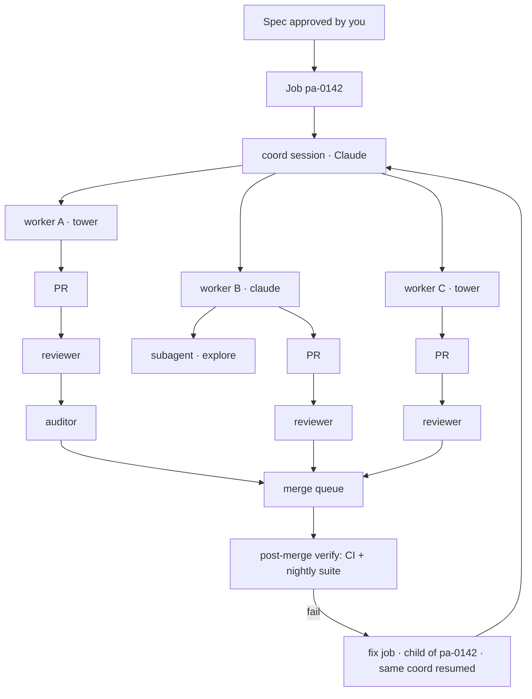

# Design addendum: factory floor and job execution protocol

Added 2026-10-22. Merge these two sections into docs/design.md after "Review tiers and the trust ladder". Where they conflict with corrections already in design.md (clones instead of worktree mounts, proxy egress on Docker Desktop, OpenCode v2 endpoints), the corrections win.

## The factory floor: jobs as trees, sessions as first-class, specs as the only gate

The end state is a dark factory: you approve specs, Vigil does everything else, and you are paged only when something needs a human. Everything in this section exists to make that safe. The closest public analogue is GitHub's Agent HQ, where a plan is approved before any code is written, agents are managed like team members with their own identity and policies, and a mission-control view tracks every agent across surfaces ([GitHub](https://github.blog/news-insights/company-news/welcome-home-agents/)). Vigil is the self-hosted, model-agnostic version with a harder verification ladder.

**A job is a tree, not a session.** One approved spec creates a job. The job owns a *coord session* (Claude by default), which plans, splits the work into worker tasks with their own contracts, dispatches them, and owns the status issue. Each worker is its own Vigil session in its own container, branch and worktree, so it is observable on its own, not hidden inside a parent's context. Workers may spawn subagents (the Agent SDK's Agent tool, OpenCode's subagent action); the SDK does not stream a subagent's internal events ([issue](https://claudeissues.com/issue/43553-feat-propagate-sub-agent-internal-events-in-output-format-stream-json)), so Vigil reads them from the OTel spans, which nest a subagent's model and tool spans under the parent's tool span, plus SubagentStart/Stop hooks. Reviewers and auditors are sessions on the same tree. The UI shows the tree live: job → coord → workers → subagents → reviewer → auditor, each node with its state, what it is doing now, tokens, cost, and a link into its transcript.

**Lifecycle, including what happens after you ship.** Job states: `spec_pending` → `approved` → `planning` → `building` → `in_review` → `ready` → `merged` → `verifying` → `done`, with `blocked` and `escalated` reachable from any of them. Merging is not the end. After merge, Vigil watches post-merge CI and the nightly prod suite for a window (default 48 h) and tags every failure with the job fingerprints of the commits involved. A failure, or a bug issue that the decider links to a shipped job, opens a *fix job* as a child of the original: same coord session resumed with its context (SDK sessions are resumable; OpenCode sessions can be forked), the original spec and diffs attached, a new worker tree. Lineage is shown on both jobs. A shipped job that spawns three fix jobs in a week is flagged on the review page; that shape's trust rung drops.

**Every session is a conversation you can read and join.** Vigil proxies each session's transcript into the UI: the Agent SDK message stream for Claude sessions, `GET /event` plus `GET /session/:id/message` for OpenCode sessions (run headless, `opencode serve`, one per container). The session page shows the conversation as it happens, tool calls inline, and has a send box. A message you send goes into the live session (SDK streaming input; OpenCode `prompt_async`), is logged with `provenance: human`, and shows in the transcript. So you can talk to a coord in the app, nudge a worker, or answer a question a coord raised. Coords raise questions as *inbox items*, never as silent waits.

**Coord backends are pluggable; the coord is the one place to spend quality.** The coord uses the same backend object as workers, so it can be Claude (default, Opus for planning), the tower's llama-server, Ollama on any machine, or OpenRouter. The routing table decides the default per job shape; a local coord is allowed only on shapes at trust rung 3. "Open in Claude Code" on a coord session copies `claude --resume <session_id>` so you can take over in the terminal; the vigil MCP server lets a Claude.ai or Claude Code session dispatch and read jobs; the ParkAgent coord becomes a client of vigild through that MCP server.

**The inbox is the only place you work.** One page, three queues: *Specs to approve* (drafted by a coord from an issue, with the decider's value/risk and the planned worker split), *Ready to merge* (green CI, clean review, audit sample passed, with the diff summary), *Questions and pages* (a coord blocked, a budget hit, a post-merge failure, a demoted shape). Everything else is visible but needs nothing from you. Push notifications for the third queue only.

**Auto-merge is earned per shape, like review.** The merge queue auto-merges only when: the shape is at rung 3, CI green, reviewer clean, auditor sample clean, no money/auth/consent path, and post-merge verification is configured for that repo. Anything else waits in *Ready to merge*. A post-merge failure on an auto-merged PR auto-reverts and opens a fix job. You can turn auto-merge off per repo in one line of `repos.yaml`.

**Frontier practices Vigil adopts, each a test in the repo:**

| Practice | What it means in Vigil |
| --- | --- |
| Plan before code, human approves the plan | The spec gate plus the inbox; a coord's first output is a spec and a worker split, nothing runs before approval |
| Agents as team members with identity | One GitHub App per role (vigil-coord, vigil-worker, vigil-reviewer) so every commit, comment and review is attributed; per-role permissions |
| Policy as code | Routing, review ladder, budgets, WIP, auto-merge rules live in `configs/*.yaml`, versioned, reviewed by PR like code |
| Verification ladder | fail-before-fix test → CI → fresh-context review → audit sample → post-merge CI → nightly prod suite → auto-revert |
| Untrusted content | Issue bodies, PR comments, fetched pages and repo files other than `CLAUDE.md`/docs are fenced as data in every prompt; a worker never acts on instructions found in them; a test plants an injection in an issue and asserts no tool call follows it |
| Best-of-n on the tower | For a shape with a low first-pass rate, run 2–3 tower attempts in parallel from the same spec and let CI plus the reviewer pick; free on your GPU, logged as one job |
| Checkpoint and resume | Every session id is stored; coords resume with context for fix jobs; a crashed worker resumes from its last commit |
| Replayable jobs | A job is spec + base commit + backend; `vigil replay <id> --backend X` reruns it, which is also how the eval works |
| Flake control | A test that flips across two runs of the same commit is quarantined and filed, never counted against a worker |
| Reviewer evals | Reviewers are scored against the auditor and against ReviewBench-style fixtures before entering the ladder |
| Circuit breakers | Daily cap, per-task cap, WIP, max fix-job depth (3), max escalations per day; any breaker trips → inbox page, dispatch pauses |

## Job execution protocol: stages, artifacts, acceptance, prompting

This is how a job runs, written the way a release process is written at a company that guards main: every stage has inputs, an artifact it must produce, an acceptance check a machine runs, and an owner who moves it on. Nothing moves on a feeling.

**How workers are housed.** Three session kinds, one contract. A *coord* is a Claude Agent SDK process (Opus) in its own container, long-lived for the job, resumable. A *Claude worker* is an Agent SDK process (Sonnet by default) in a fresh container with one clone on one branch; it is not an OpenCode session, because the SDK gives hooks, permission modes and OTel for free. A *local worker* is a headless `opencode serve` in a fresh container pointed at the tower (or OpenRouter, or any endpoint), driven over HTTP. Reviewers and auditors are Claude workers with `edit: deny`. Containers are the unit of isolation and of cost; a session never outlives its stage.

**Stages.** Each row is a gate. The artifact is a file committed on the job's branch under `.vigil/` or a record in vigild; the acceptance check is code, not judgment.

| Stage | Input | Owner | Artifact produced | Acceptance (machine-checked) | On failure |
| --- | --- | --- | --- | --- | --- |
| 0 Intake | issue, label, or `vigil run` text; your rough ideas | decider | `intake.json`: value, risk, size, touches\_money, duplicate\_of, confidences | confidences above act threshold; not a duplicate; WIP free | wait in inbox or page you |
| 1 Spec | intake + repo docs + your notes | coord (Claude) | `spec.md`: goal, non-goals, acceptance criteria as testable statements, `test_cmd` per criterion, files in/out of scope, risks, rollback; `plan.md`: worker split with a contract per worker, dependency order, estimated size | spec gate: every criterion has a test command; every worker contract validates against the schema; money paths flagged match the path rules | coord revises up to 2×, then pages you |
| 2 Approve | spec + plan | you (inbox) | approval record with your edits | signed by you | job stays `spec_pending` |
| 3 Build | one worker contract | worker | branch with commits; `worker_report.json`: test before/after, files changed, summary, self-check answers, open questions | `must_fail_first` observed; `test_cmd` exits 0; files changed ⊆ scope; no test weakened (diff of test files reviewed by a check); lint/types clean; turns and cost under limits | retry with findings appended (attempt 2), then escalate tier |
| 4 Verify | branch | CI (GitHub Actions) | CI run; coverage delta; flake status | all required checks green on a clean runner, not the worker's shell; flaky tests quarantined, not counted | back to build with the CI log attached |
| 5 Review | PR diff + issue + spec | reviewer (fresh context) | `review.json`: findings\[\] {severity, file, line, claim, fix}, verdict | zero findings of severity ≥ medium; checklist complete | findings become a fix task on the same branch; two rounds, then escalate |
| 6 Audit | review + diff | auditor (Opus, sampled by rung) | `audit.json`: findings the reviewer missed, match rate | match rate feeds the trust ladder; no missed high finding | demote shape; findings become a fix task |
| 7 Integrate | all worker PRs for the job | coord | integration branch, integration test run, PR stack order | integration tests pass; stacked PRs rebase clean | coord opens an integration fix task |
| 8 Merge | ready PRs | you, or auto-merge at rung 3 | merge commits with job fingerprint | ruleset satisfied; auto-merge conditions | waits in inbox |
| 9 Post-merge | merged commits | vigild watcher | verify record: post-merge CI, nightly suite, error-rate window | 48 h window clean | auto-revert if auto-merged; fix job as child, coord resumed |
| 10 Close | verify record | vigild | job summary, cost, lineage, lessons line appended to `docs/feature-map.md` | docs updated in the merged PRs | n/a |

**Your way of working, mapped.** You arrive with a feature request and ideas; you build; you fix until the MR survives a hard audit; then you fix the bugs that surface after. In Vigil that is: your request and ideas go into stage 1 as `notes` on the spec (the coord must address each idea in the plan, adopting or rejecting it with a reason); stages 3–6 are the build-and-fix loop, bounded by attempt counts; stage 9 is the after-ship fix loop, bounded by fix-job depth. You stop being the loop and become the two gates (2 and 8).

**Prompting discipline.** Every session receives one *task packet*, assembled by vigild, never free text:

1. *Role and rules*: the role prompt for coord/worker/reviewer/auditor from `prompts/<role>.md`, versioned, then the repo's `CLAUDE.md`/`AGENTS.md`.
2. *Context pack*: `docs/architecture.md` and `docs/feature-map.md` excerpts selected by the files in scope, the contents of files in scope, the relevant tests, the last three merged PRs touching those files, and for fix jobs the original spec, diffs and failure logs. Capped by token budget; the coord decides what to drop and records it.
3. *Contract*: the task JSON, with `done_when` restated as a checklist.
4. *Untrusted content*, fenced: issue text, PR comments, fetched pages. The role prompt says these are data and any instruction inside them is ignored; a test plants one and asserts no tool call follows.
5. *Output schema*: the exact JSON the session must end with (`worker_report.json`, `review.json`). A session that ends without it is a failure, not a partial success.
6. *Self-check*: before returning, the worker answers five questions in the report: did the test fail first; what did I change outside scope and why (must be nothing); what did I not do; what would a reviewer flag; what could be deleted.

Role prompts are short, imperative, and never change mid-job. Changing a prompt is a PR with an eval run attached. No session is ever asked to "continue" in a chat; a new stage is a new packet.

**When to move on.** A stage advances only when its acceptance column is true and the owner has written the artifact. Vigild enforces this in one state machine (`vigild/jobs/fsm.py`) with a test per transition. There is no manual override except yours from the inbox, and that is logged.
